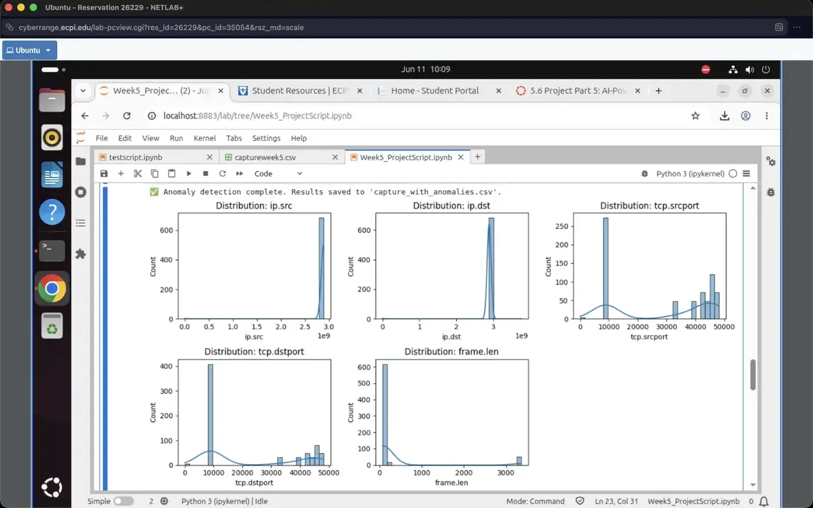
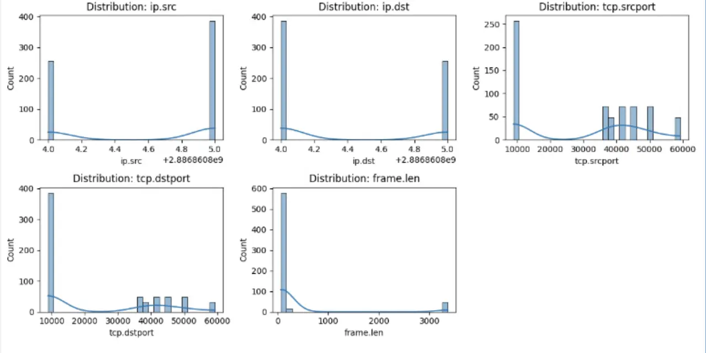
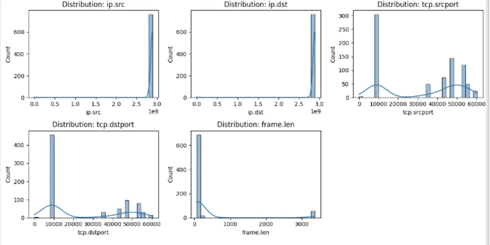
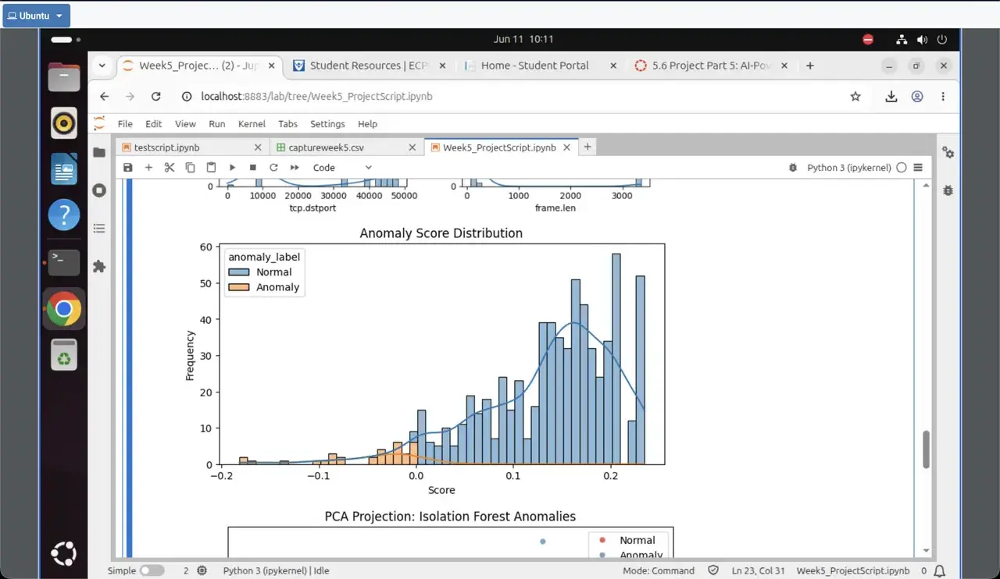
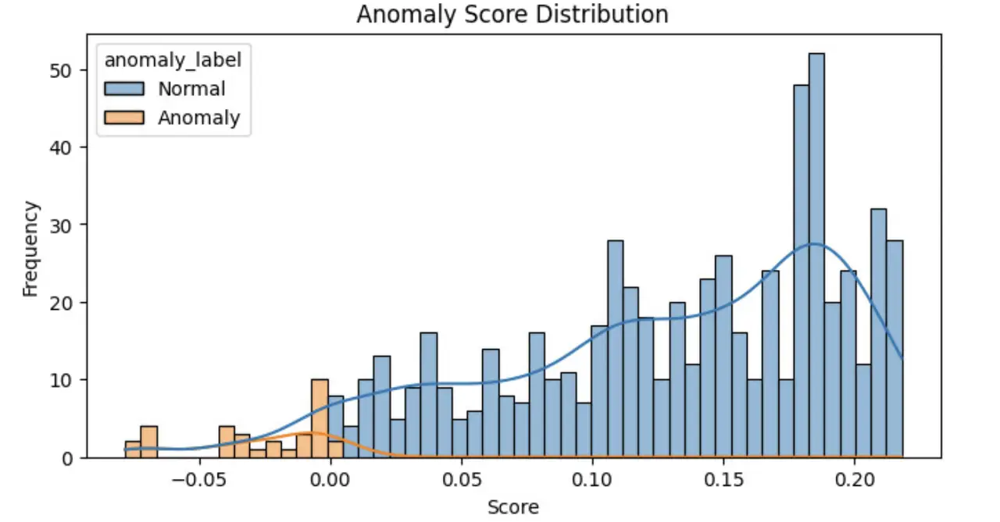
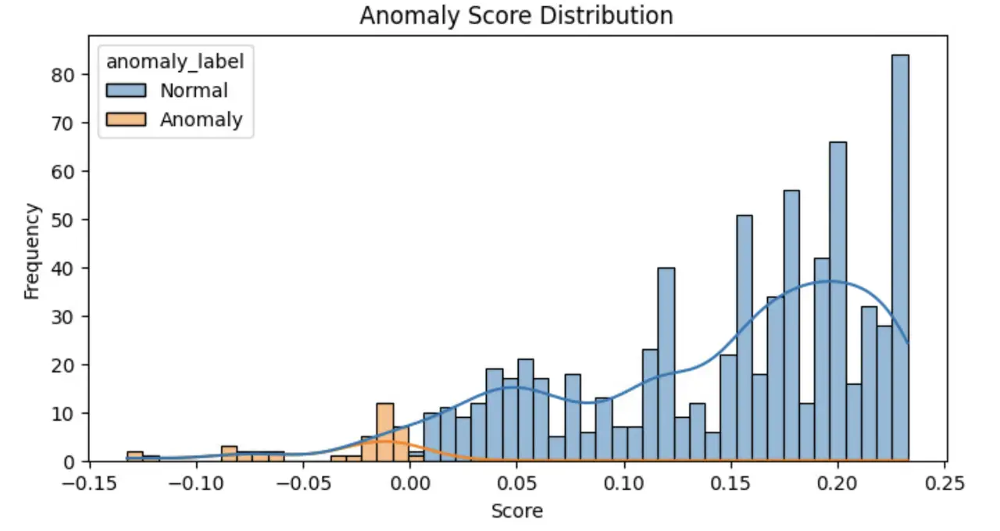
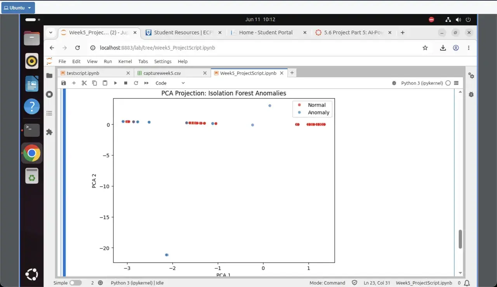
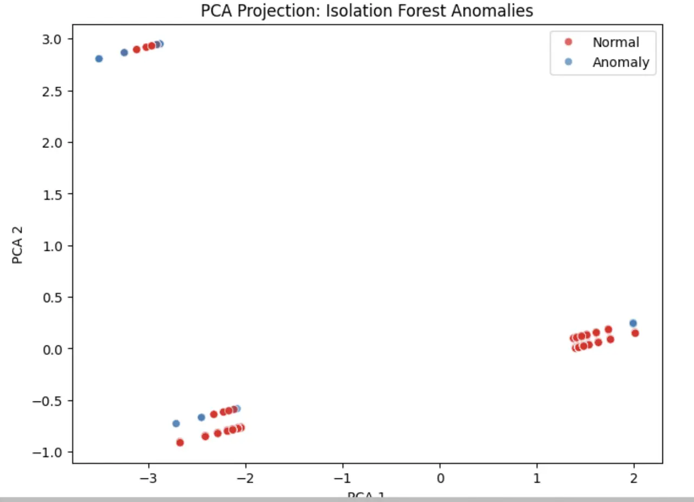
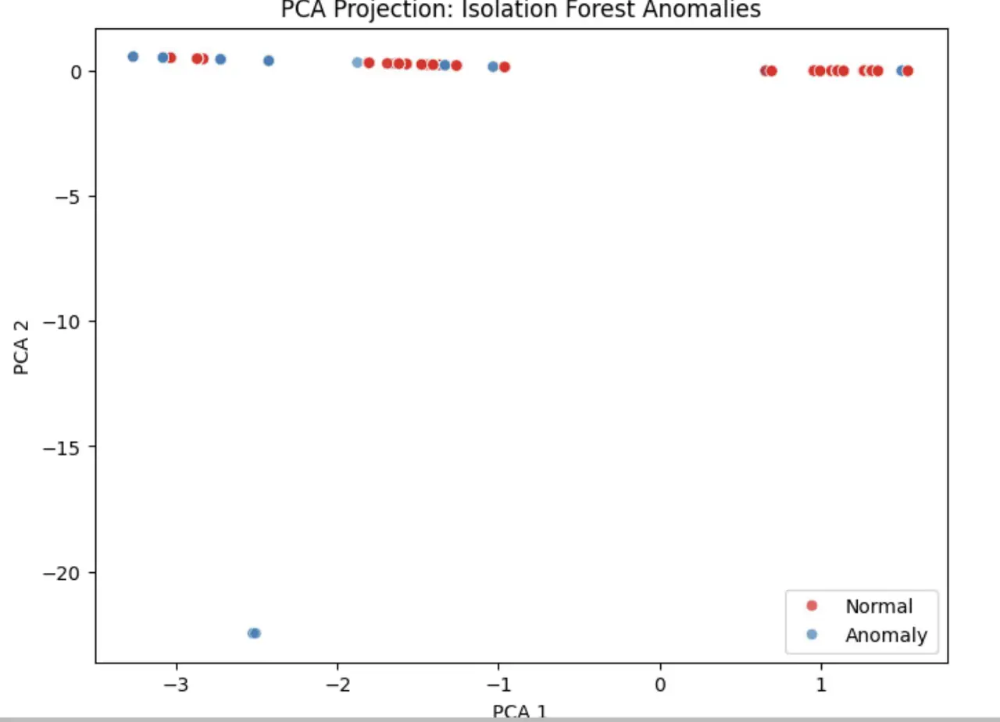

# AI-Assisted Incident Investigation and Live Response Report

**Course:** CST440 AI/Machine Learning · ECPI University · Jun 2026  
**Work:** Individual

## Scenario

Suspicious activity across simulated lab systems was investigated over four weeks with network discovery, packet capture, live response and malware analysis; the final report validates the manual findings with an Isolation Forest anomaly-detection model.

## Skills and tools

- **Skills:** Incident response, Live response, Packet capture, Anomaly detection, Report writing
- **Tools and references:** Jupyter Notebook, Python (scikit-learn Isolation Forest), Wireshark, Nmap, Linux live response commands

## My work

*Converted from my original submission. The assignment prompt, grade and instructor feedback are not included.*

**Contents**

[**Live Response Analysis of \<Hostname\> 3**](#live-response-analysis-of-infected-hostname)

> [Findings 3](#findings)
> 
> [Evidence Examined 3](#evidence-examined)
> 
> [Analysis Details 4](#analysis-details)

\+

###  Live Response Analysis of \<Infected Hostname\>

This investigation began after suspicious activity was observed in the lab environment across multiple simulated systems. The case was developed over four weeks using network discovery, packet capture, live response commands, malware/dynamic analysis, and AI-assisted anomaly detection. The final phase validates the manual findings with an Isolation Forest model in Jupyter Notebook.

All timestamps in this report are in Coordinated Universal Time (UTC), unless otherwise noted.

#### Findings

  - **The earliest identified date of compromise occurred on \<DATE\>.**

The network traffic was successfully captured and converted into a structured dataset suitable for machine learning analysis.

  - **Finding Two**

The Isolation Forest model identified a limited number of anomalous observations that differed from normal traffic patterns

  - **Finding Three**

PCA visualizations confirmed that anomalous observations were separated from the primary traffic clusters, supporting the model’s findings.

**The most recent identified malicious activity occurred on June 11, 2026**

#### Evidence Examined

##### System Information

| **Hostname**   | **Domain**                                        | **Operating System** |
| -------------- | ------------------------------------------------- | -------------------- |
| Analysis       |                                                   | Ubuntu               |
| **IP Address** | **System Function**                               |                      |
| 172.18.0.5     | Container is used for packet capture and analysis |                      |

*Table 1: System information*

##### Volume Information

| **Volume Name** | **File System** | **Logical Size** |
| --------------- | --------------- | ---------------- |
|                 |                 |                  |
|                 |                 |                  |

*Table 2: Volume information*

##### Evidence Description

| **Tag** | **MD5 Hash**                                                         | **Collection Date** | **Description**                          |
| ------- | -------------------------------------------------------------------- | ------------------- | ---------------------------------------- |
| 001     | **ae484017876d3ada3dc3b67ad182138a**                                 | June 8, 2026        | Hash sum of capture\_with\_anomalies.csv |
| 002     | **7104cb166f7010c6a44188b38e64eb55e7d27f1e**                         | June 8, 2026        | Hash sum of capture\_with\_anomalies.csv |
| 003     | **2f7ded0657128a7a27f20fce4180911dccf4665e4e1559bb0be02fd784111ac6** | June 8, 2026        | Hash sum of capture\_with\_anomalies.csv |

*Table 3: Evidence description*

##### Analyst Information

| **Analyst Name**     | Marvin Castro Hernandez        |
| -------------------- | ------------------------------ |
| **Analyst Email**    | <[email redacted]> |
| **Date of Analysis** | June 11, 2026                  |

*Table 4: Analyst information*

##### Analysis Software

| **Analysis Software** | **Version** |
| --------------------- | ----------- |
| Wireshark             |             |
| NMAP                  |             |

*Table 5: Analysis software*

#### Analysis Details

The following section provides the evidence that supports the findings.

You may present the analysis details in one of two formats: categorically or chronologically: Do not alternate between these two formats. Use Heading 3 to separate the findings either by month or by evidence type.

**Chronologically** is the preferred type and presents all evidence in the order that it occurred on the system. When using the chronological format and no date is associated with the data, place those findings near other findings that are relevant.

##### Month Year

##### Month Year

**Categorically** groups findings by evidence type such as registry findings, event log findings, etc.

##### File System Details

##### Registry Details

##### Log Analysis

### Feature Analysis

Figure . Feature distribution analysis from the analysis container

Figure . Feature distribution analysis from notebook-a

Figure . Feature distribution analysis from notebook-b

Figures above show the distributions of the extracted network features. The data show a concentration on a limited number of hosts and service ports, while several values occur less frequently and may indicate unusual network behavior. These features served as the basis for anomaly detection using the Isolation Forest model

### Isolation Forest Results

Figure . Isolation Forest anomaly score distribution for analysis container

Figure . Isolation Forest anomaly score distribution for notebook-a

Figure . Isolation Forest anomaly score distribution for notebook-b

The Isolation Forest model assigned anomaly scores to all observations within the dataset. Most traffic was classififed as normal behavior, while a smaller subset received lower anomaly scores and was flagged for investigation. The distribution graphs indicate that anomalous observations represent only a small portion of the overall network activity

### PCA Visualization

Figure . PCA visualization of Isolation Forest results for analysis container

Figure . PCA visualization of Isolation Forest results for notebook-a

Figure . PCA visualization of Isolation Forest results for notebook-b

PCA was used to reduce the dataset's dimensionality and visualize the Isolation Forest results. Most observations formed distinct clusters representing normal traffic patterns. Several observations appeared isolated from the primary clusters and corresponded to anomalies identified by the model. These visualizations support the effectiveness of the anomaly detection process
