# Malware Analysis and Threat Intelligence: Static and Dynamic Analysis

**Course:** CST440 AI/Machine Learning · ECPI University · Jun 2026  
**Work:** Individual

## Scenario

Suspicious traffic in a containerized Ubuntu environment was examined with static analysis (file inspection, strings, hashing) and dynamic analysis (strace, lsof, tcpdump, process monitoring) to identify anomalous communications and indicators.

## Skills and tools

- **Skills:** Malware analysis, Indicators of compromise, Threat intelligence, Evidence handling
- **Tools and references:** strace, lsof, tcpdump, sha1sum / sha256sum, Docker, Ubuntu

## My work

*Converted from my original submission. The assignment prompt, grade and instructor feedback are not included.*

**4.6 Project Part 4: Malware Analysis and Threat Intelligence**

**

**4.6 Project Part 4: Malware Analysis and Threat Intelligence**

**Week 4 - Static and Dynamic Analysis**

**Prepared By:** Marvin Castro Hernandez

**Date:** June 8, 2026

**Executive Summary**

This analysis examined suspicious network activity identified within a containerized Ubuntu environment. Static analysis was performed on captured network traffic and anomaly datasets using file inspection, string extraction, and cryptographic hashing. Dynamic analysis was conducted using strace, lsof, tcpdump, and process monitoring tools to observe system behavior and network communications

The investigation identified multiple anomalous communications between containerized systems operating Jupyter Lab services on TCP port 8888. Additional anomalies were traced to IPv6 multicast service discovery traffic, including mDNS and ICMPv6 packets. No direct evidence of malware execution was identified; however, several network behaviors were documented as indicators requiring further investigation

**Methodology**

  - **Analysis Date:** June 8, 2026

  - **Samples Analyzed:**
    
      - Capture\_with\_anomalies.csv
    
      - Capture.csv
    
      - Capture.pcap
    
      - Lab-capture.pcap

  - **Environment:** Ubuntu Container (isolated)
    
      - Analysis container
    
      - Notebook-a container
    
      - Notebook-b container

**Static Analysis**

**File Properties (ls -la)**

File inspection identified multiple packet captures, anomaly datasets, Jupyter notebooks, and supporting scripts within the workspace. The executable script check\_artifacts.sh was present along with several PCAP and CSV files used for analysis

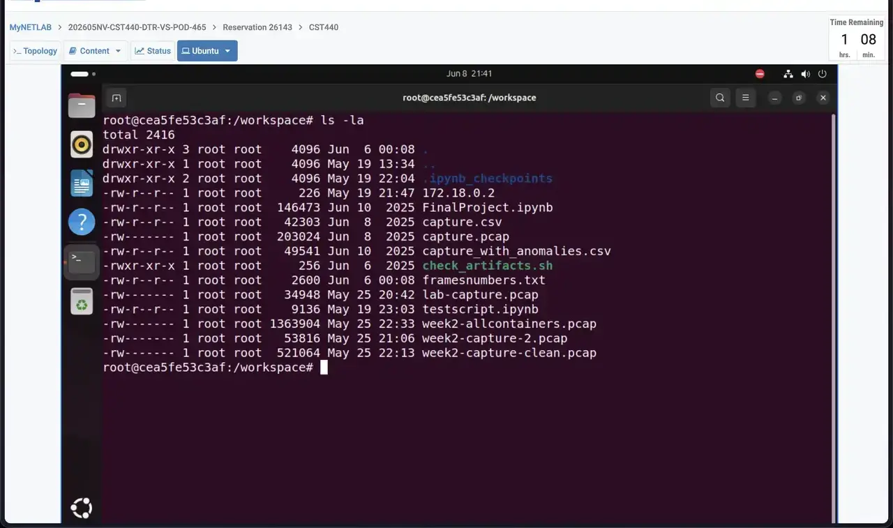

Figure 1 – analysis file properties and permissions

**String Analysis (strings command)**

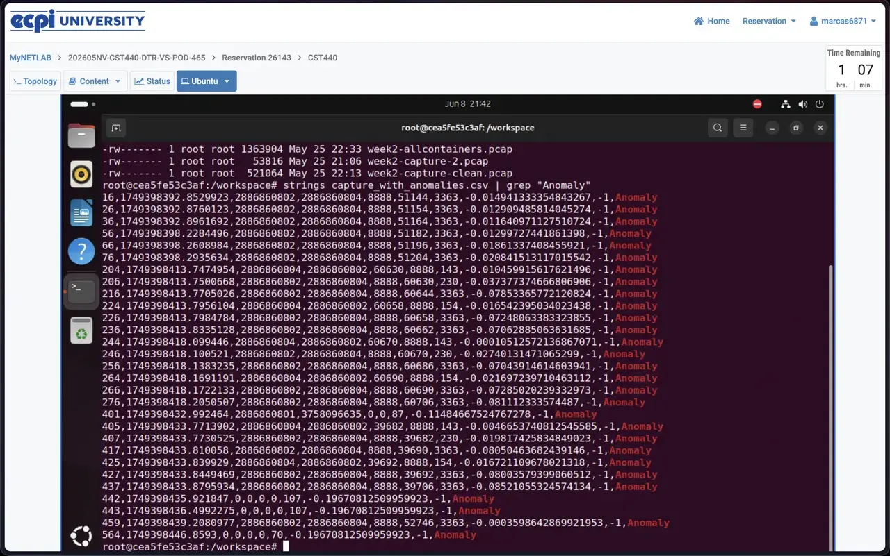

Figure 2 – capture\_with\_anomalies.csv extraction of anomaly

String extraction was performed against capture\_with\_anomalies.csv. Filtering for the keyword “Anomaly” identified the records flagged by the machine learning model. These records contained frame numbers, timestamps, source and destination IP addresses, TCP ports, packet info, and anomaly scores

**Observed anomaly characteristics included:**

  - Repeated communications between container systems

  - Frequent use of TCP port 8888

  - Large packet lengths (3363 bytes)

  - Multiple negative anomaly scores

  - Several records with missing IP and port info

  - **Suspicious Strings:**
    
      - Multiple anomaly records identified
    
      - TCP port 8888 activity observed
    
      - Container-to-container communications detected

  - **URLs/IPs Found:** Yes

**File Hash Analysis**

Cryptographic hashes were generated for capture\_with\_anomalies.csv to establish file integrity and provide file-based indicators. However, I was unable to sniff out any anomalies.

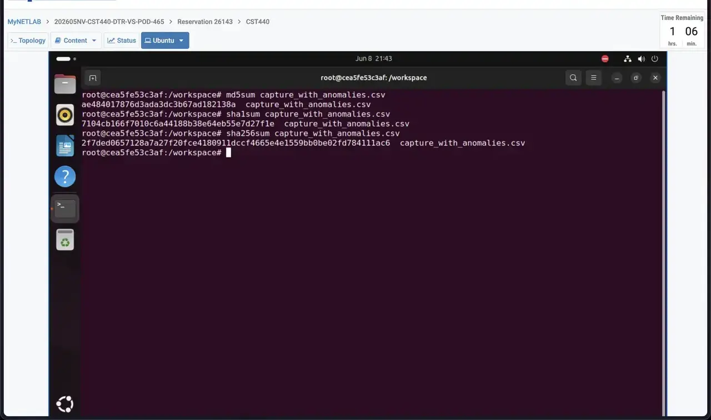

Figure 3 – Hash analysis of capture\_with\_anomalies.csv

**Dynamic Analysis Setup**

**Monitoring Tools Initialization**

Dynamic analysis tools were initialized to observe system behavior during execution. The strace utility was used to monitor system calls, **lsof** to identify open files and network sockets, **tcpdump** to capture network traffic, and **ps aux** to monitor active processes. These tools provided visibility into file access, process activity, and network communications occurring within the containerized environment

**Behavioral Analysis**

**System Call Tracing (strace)**

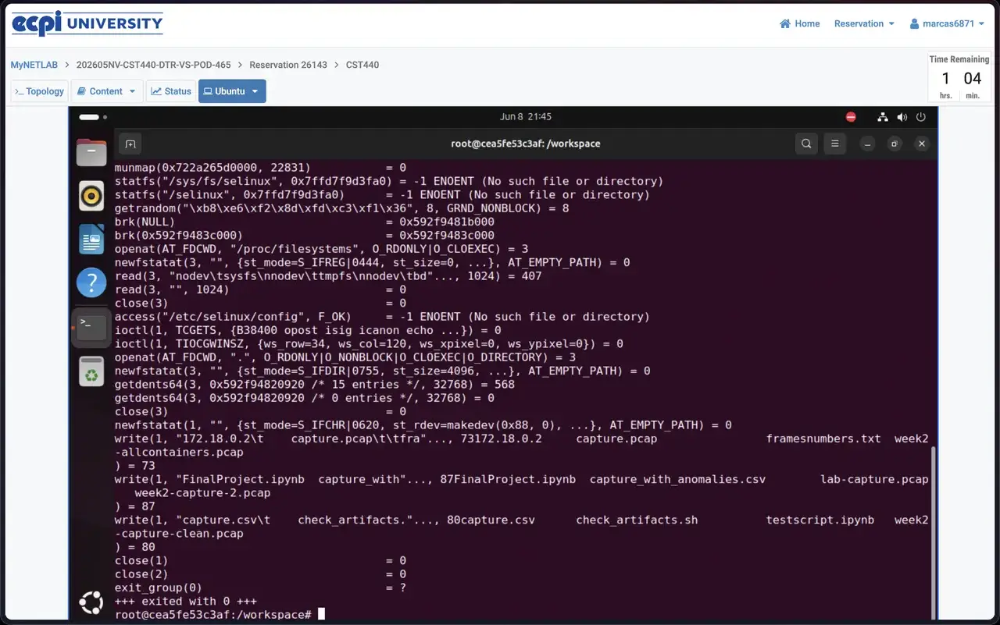

Figure 4 – strace ls command executed

System call tracing revealed normal execution behavior for the Linux ls command. Observed system calls included execve, opennat, getdents64, and write. These calls demonstrated file access, directory enumeration, and output generation. No suspicious system calls associated with malware execution, privilege escalation, or persistence mechanisms were identified.

**File System Monitoring (lsof)**

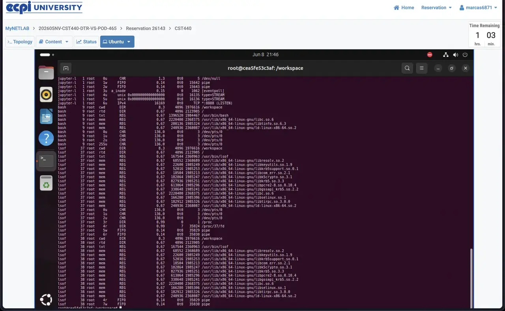

Figure 5 – lsof command

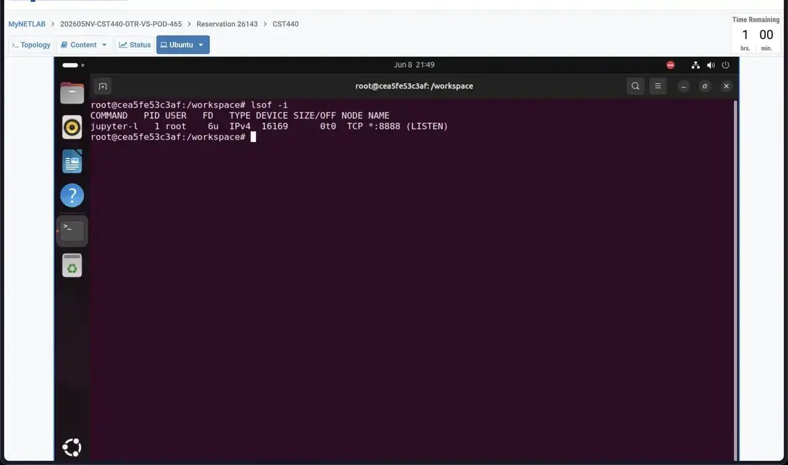

Figure 6 – lsof -I command showing Jupyter Lab process

File monitoring identified the Jupyter Lab process and its associated Python libraries activity loaded into memory. Numerous system libraries and Python modules were accessed during execution. No unauthorized file creation, deletion, or modification activity was detected. Observed file activity was consistent with normal Jupyter Lab operation

**Network Activity Capture (tcpdump)**

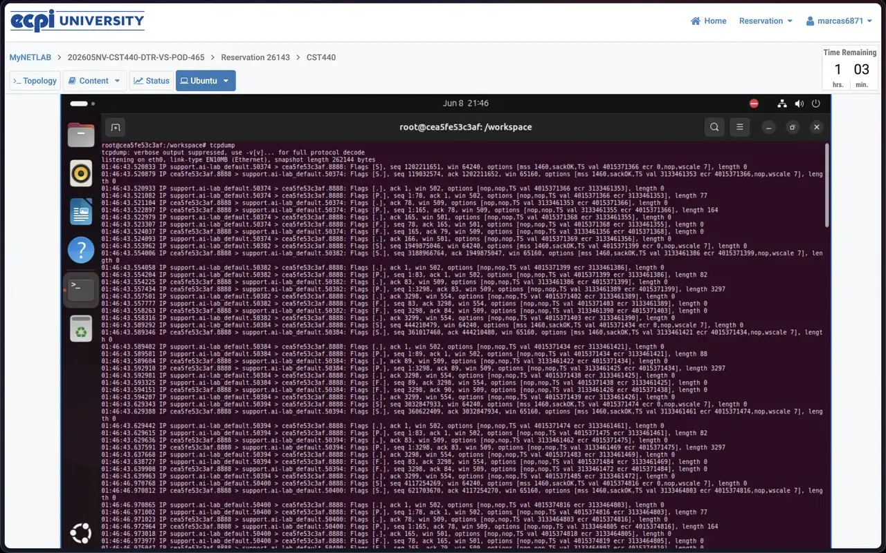

Figure 7 – TCPdump showing communications between containers

Network traffic captures revealed communication between containerized hosts operating within the 172.18.0.0/16 Docker network. TCP sessions were observed on port 8888, corresponding to Jupyter services. Traffic consisted primarily of session establishment, acknowledgments, and data transfer operations. No external internet communications were identified during monitoring

**Process Monitoring**

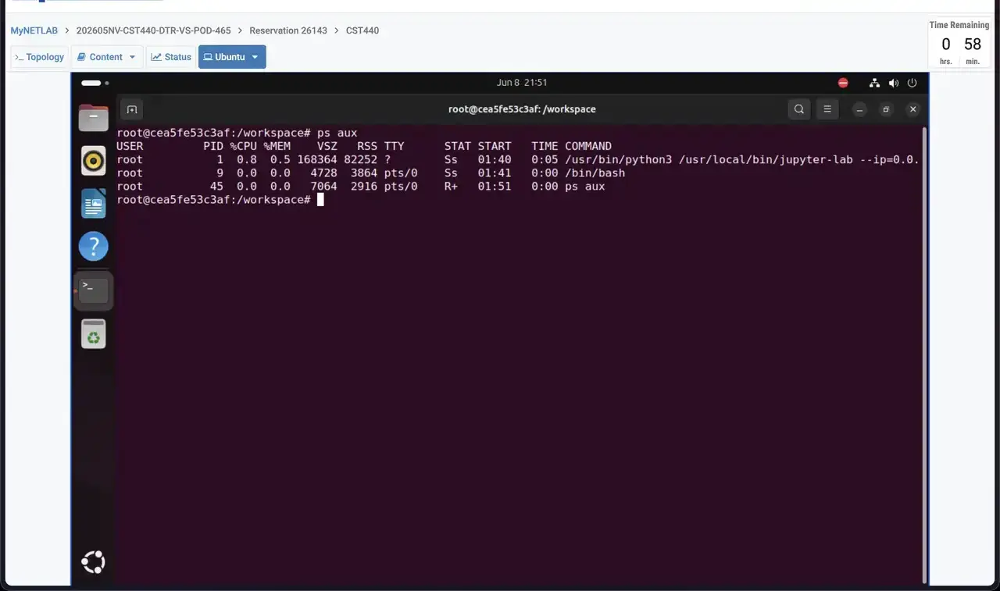

Figure 8 – active processes analysis container

Process monitoring identified active Python-based Jupyter services running in each container. Supporting Bash shell processes were also present during analysis activities. No unauthorized child processes, persistence mechanisms, or suspicious executables were observed

**Malware Behavior Profile**

**File System Changes**

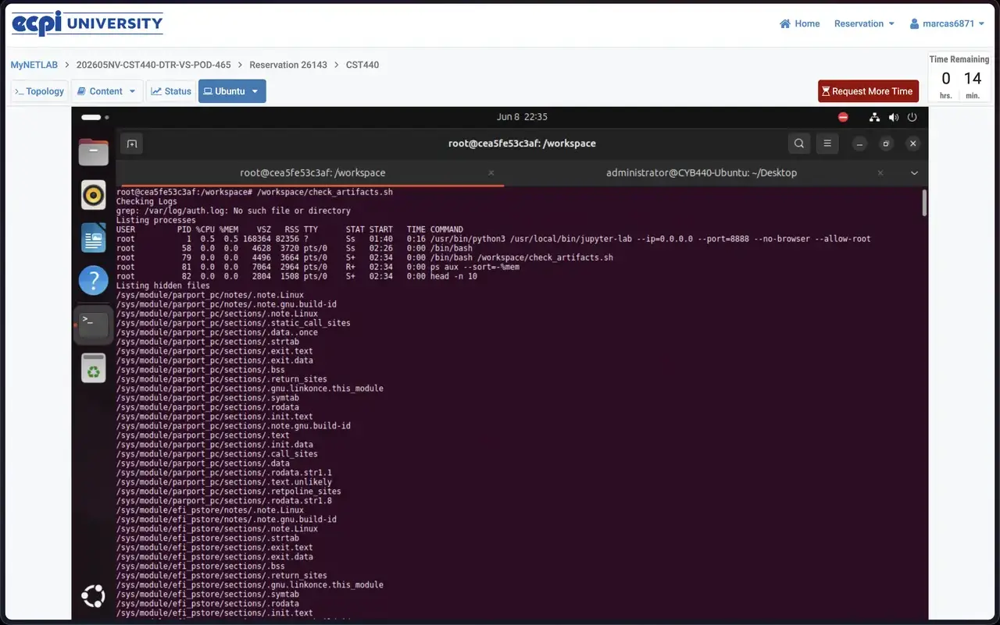

Figure 9 – hidden files and processes

File system monitoring did not identify evidence of malware file modifications. The workspace contained packet captures, anomaly datasets, notebooks, and supporting scripts. Open file analysis showed normal access to Python libraries, configuration files, and workspace directories associated with Jupyter Lab operation

**Network Communications**

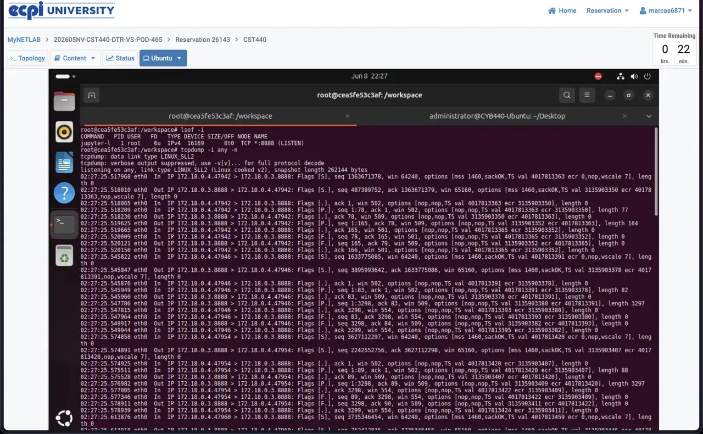

Figure 10 – tcpdump

Network communications were observed between containerized hosts utilizing TCP port 8888. Repeated communication between 172.18.0.2 and 172.18.0.4 was identified in the anomaly dataset. Additional multicast communication was observed via IPv6 mDNS and ICMPv6 traffic. These communications were consistent with service discovery and application connectivity within the docker environment

**Process Activity**

Figure 11 – active processes

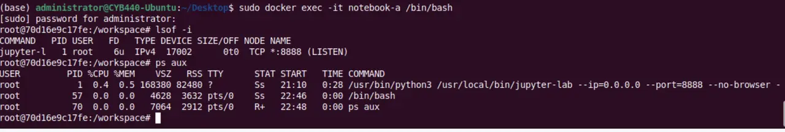

Figure 12 – active processes notebook-a

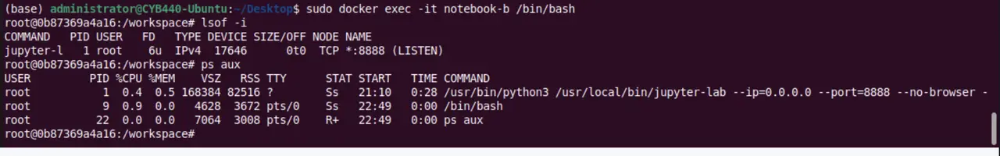

Figure 13 – active processes notebook-b

Active processes included Jupyter Lab, Python runtime components, and interactive Bash shells. No suspicious child processes were spawned during monitoring. Process behavior remained consistent with the normal operation of containerized Jupyter notebook services

**Indicators of Compromise (IOCs)**

**File-Based IOCs**

| Hash Type | Value                                                                | Detection Confidence |
| --------- | -------------------------------------------------------------------- | -------------------- |
| MD5       | **ae484017876d3ada3dc3b67ad182138a**                                 | *High*               |
| SHA1      | **7104cb166f7010c6a44188b38e64eb55e7d27f1e**                         | High                 |
| SHA256    | **2f7ded0657128a7a27f20fce4180911dccf4665e4e1559bb0be02fd784111ac6** | High                 |

**Network-Based IOCs**

Figure 14 – Network indicators of compromise

Network indicators included repeated communication between container hosts 172.18.0.2 and 172.18.0.4 using TCP port 8888. Additional anomalous traffic involved IPv6 multicast DNS (UDP 5353) and ICMPv6 discovery traffic. These indicators were flagged by the anomaly detection model and investigated using packet-level analysis

**Advanced Analysis (Optional)**

**Custom Detection Rules**

*\[Insert screenshot of YARA rule development\]*

**Threat Intelligence Cross-Reference**

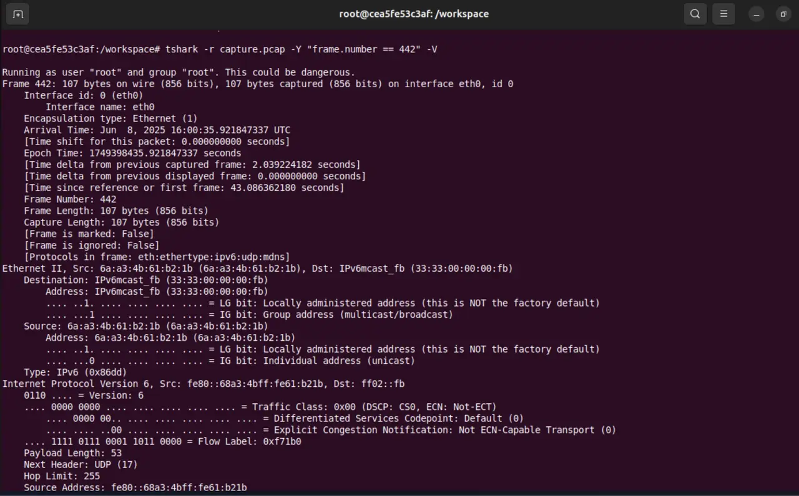

Figure 15 – frame analysis 442

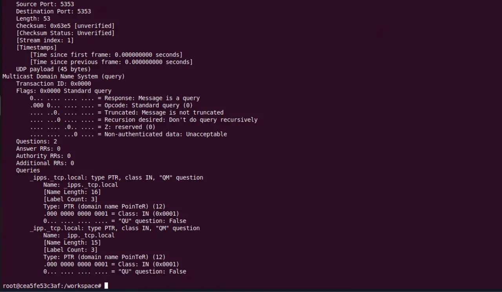

Figure 16 – frame analysis 442 (cont.)

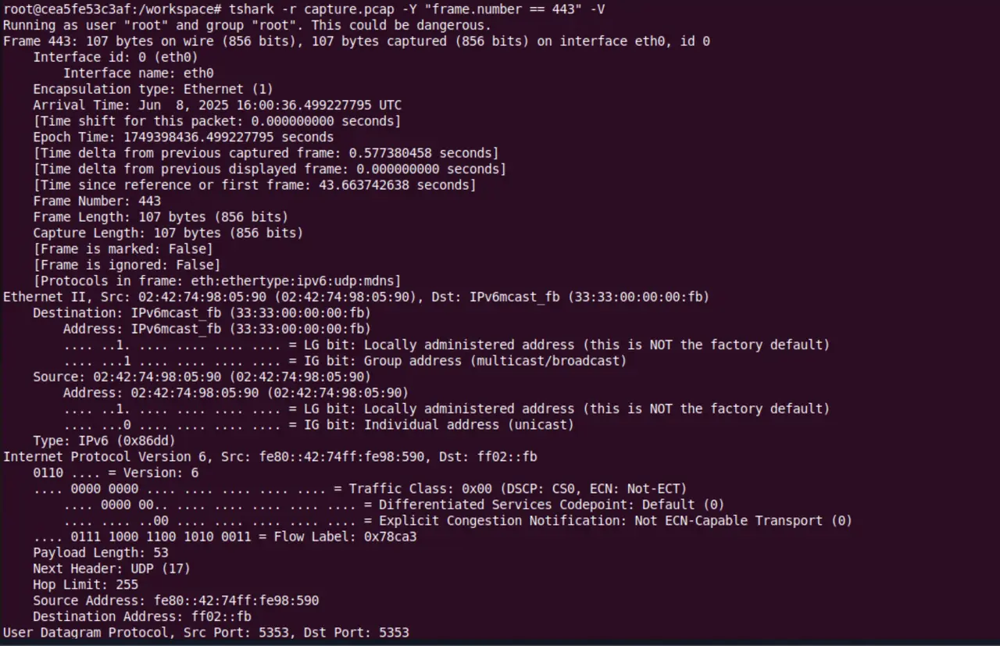

Figure 17 – Frame Analysis 443

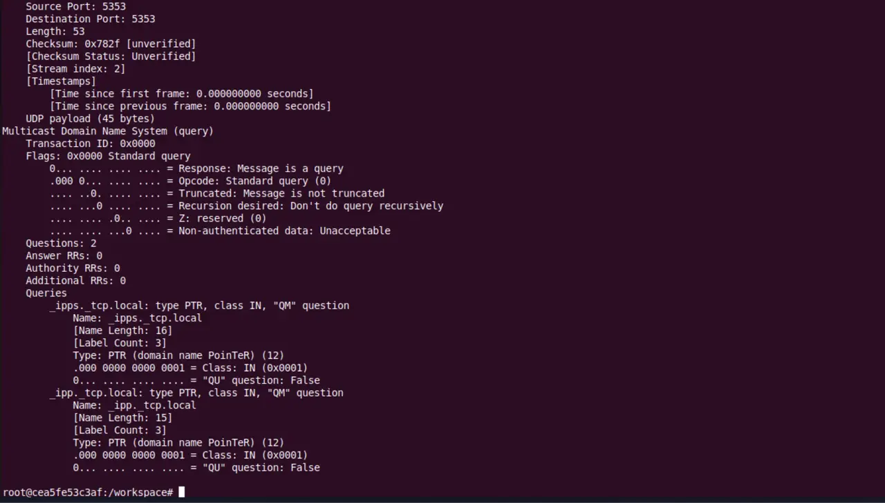

Figure 18 – Frame Analysis 443 (cont.)

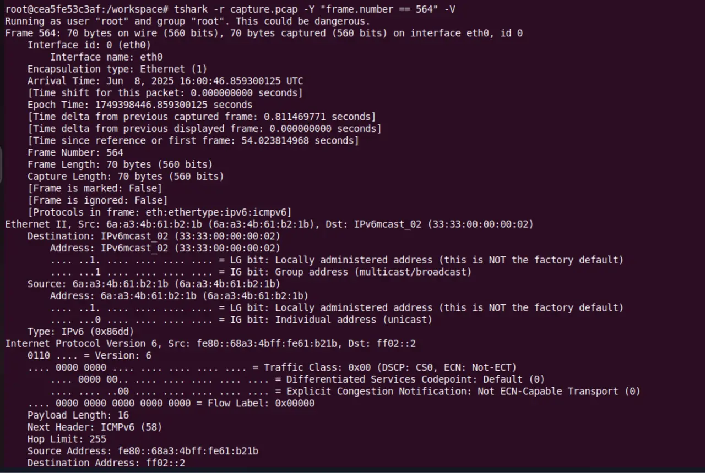

Figure 19 – Frame Analysis 564

No threat intel matches were identified during analysis. Packet inspection determined that frames 442 and 443 contained legitimate mDNS service discovery traffic using UDP port 5353, while frame 564 contained ICMPv6 router discovery communications. These protocols are commonly observed within a containerized Linux environment and do not indicate malware activity

**Malware Classification**

| Sample                       | Malware Type           | Threat Level | Primary Behavior                 |
| ---------------------------- | ---------------------- | ------------ | -------------------------------- |
| Capture\_with\_anomalies.csv | *\[Trojan/Worm/etc.\]* | Low          | Internal container communication |
|                              |                        |              |                                  |

**Key Findings**

  - Multiple anomalous communications were identified between containers 172.18.0.2 and 172.18.0.4.

  - Repeated activity was observed on TCP port 8888, associated with Jupyter Lab services

  - Machine learning analysis identified unusual traffic patterns within the packet capture dataset

  - Frames 442 and 443 were determined to contain IPv6 mDNS service discovery traffic on UDP port 5353

  - Frame 564 contained ICMPv6 multicast discovery traffic, which is normal network operations

**Detection Recommendations**

  - Monitor communications involving TCP port 8888 between containerized systems

  - Establish baselines for normal Jupyter Lab traffic and alert on significant deviations

  - Implement network monitoring for excessive mDNS or multicast discovery activity

  - Correlate machine learning anomaly detections with packet-level inspection before escalating incidents

  - Continue monitoring container-to-container communications for unauthorized services or unexpected behavioral changes
