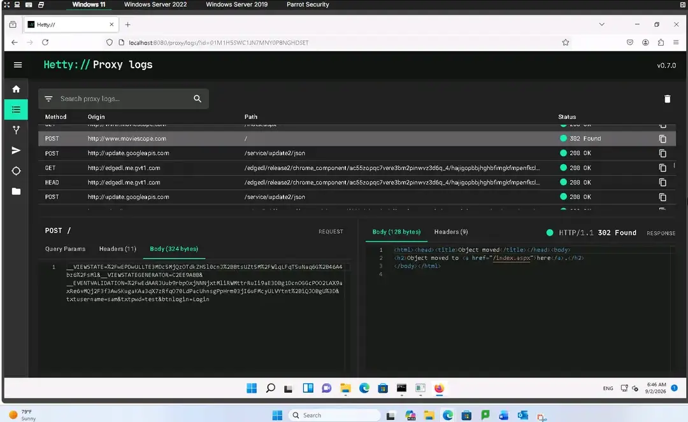
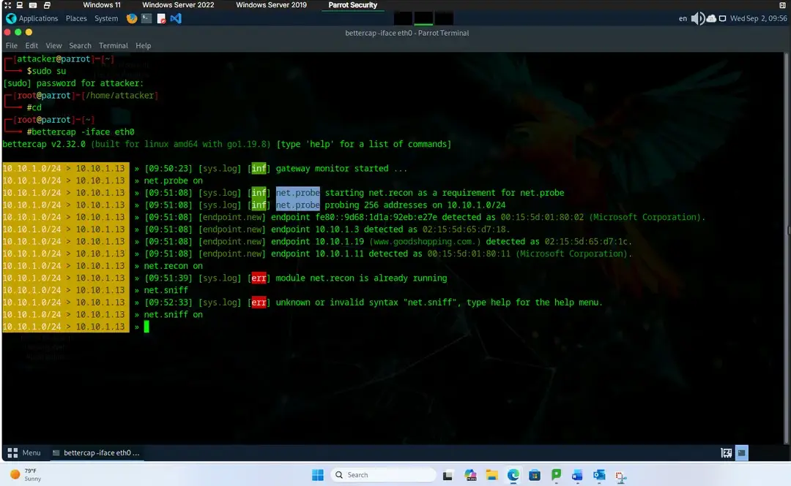
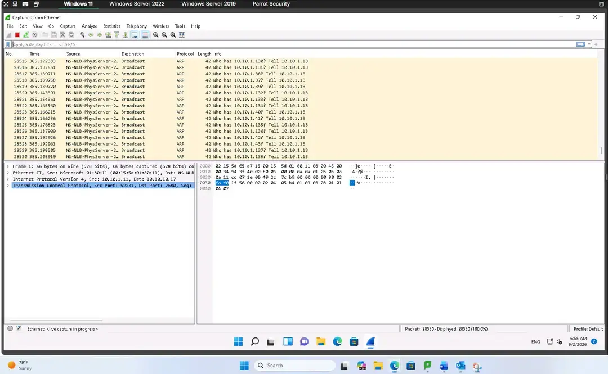
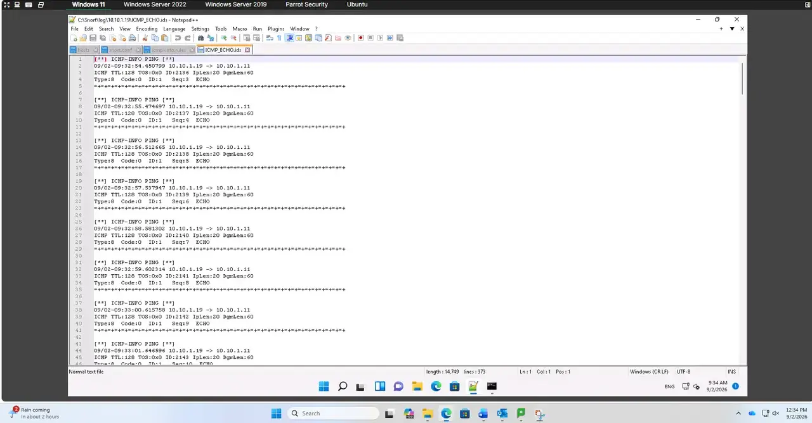
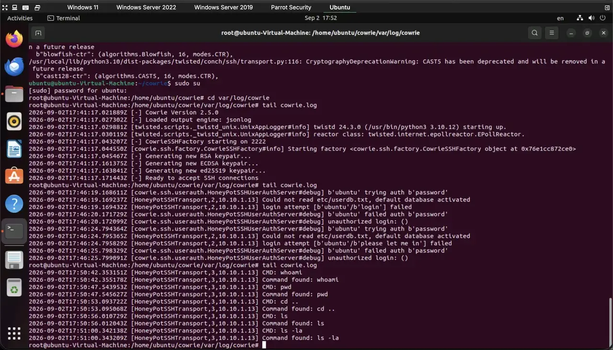
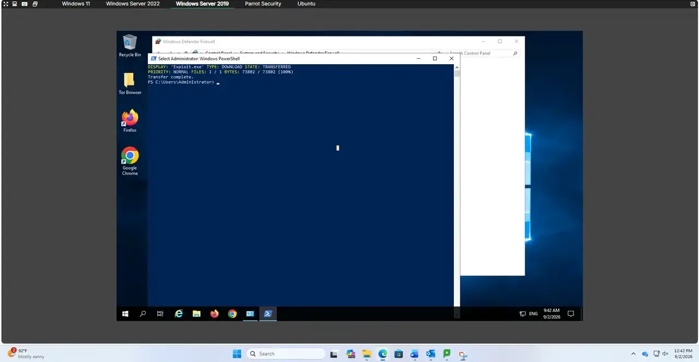
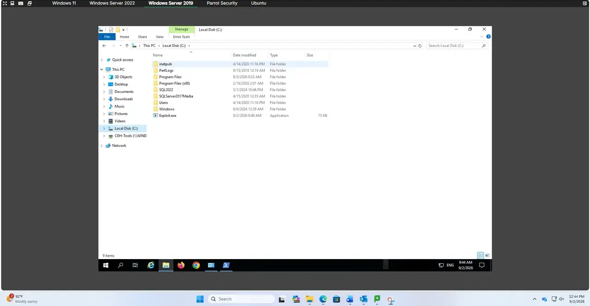

# Session Hijacking and Firewall/IDS Evasion Lab

**Course:** CYB410 Ethical Hacking II · ECPI University · Oct 2026  
**Work:** Individual

## Scenario

Hands-on lab work hijacking sessions and testing firewall and IDS evasion techniques, documented with screenshots and a summary of detection takeaways.

## Skills and tools

- **Skills:** Session hijacking, IDS/firewall evasion, Packet analysis
- **Tools and references:** Wireshark, Snort, Nmap, Linux

## My work

*Converted from my original submission. The assignment prompt, grade and instructor feedback are not included.*

**1.4 Lab Assignment: Session Hijacking and Evading Firewalls Lab**

| **Activity Type** | **Session Hijacking and Evading Firewalls and IDS-Lab** |

###  Tasks and Screenshots

Complete the following lab tasks in the **Session Hijacking** iLab Module:

1.  **Lab 1** – Perform Session Hijacking
    
      - **Task 1 –** Hijack a Session using Caido
        
        1.  Screenshot step 38.

  - **Task 2 –** Intercept HTTP Traffic using Hetty
    
    1.  Screenshot step 25.

**  
**

2.  **Lab 2** – Detect Session Hijacking
    
      - **Task 1 –** Detect Session Hijacking using Wireshark
        
        1.  Screenshot step 11.

2.  Screenshot step 12.

  - **Task 1 –** Detect Session Hijacking using Wireshark
    
    1.  Screenshot step 16.

Complete the following lab tasks in the **Evading IDS and Firewalls** iLab Module:

1.  **Lab 1** - Perform Intrusion Detection using Various Tools
    
      - **Task 1** – Detect Intrusions using Snort

> 1\. Screenshot step 68.
> 
> 

**  
**

  - **Task 2 –** Deploy Cowrie Honeypot to Detect Malicious Network Traffic

> 1\. Screenshot 25.

**  
**

2.  **Lab 2** – Evade Firewalls using Various Evasion Techniques
    
      - **Task 1** – Evade Firewall the Windows BITSAdmin  
        1\. Screenshot step 14

  
2\. Screenshot step 15

### **Summary**

Write a few paragraphs summarizing the key skills you have acquired during this lab.

**Lab 1:**

I developed skills in the defensive aspects of network monitoring. Initially, I installed and set up Snort on a Windows 11 VM, configuring official rule sets, editing configuration files to define external variables, and specifying preprocessor and dynamic library paths. I created a custom Snort rule to detect ICMP ping probes, validated it by generating traffic from a simulated attack machine, analyzing Snort alerts, and reviewing log files. Next, I deployed a Cowrie honeypot on an Ubuntu VM, using authbind to allow the honeypot to bind to privileged ports. I simulated an attack from the Parrot VM by port scanning with Nmap, brute forcing SSH credentials with PuTTY, and executing basic post-access reconnaissance commands like id, whoami, and ls. I verified that Cowrie logged every step of these interactions. 

**Lab 2:**

This lab shifted the perspective to the offensive approach and explained why firewalls and IDS platforms do not prevent a highly motivated attacker. I used Windows BITAdmin, a built-in background file transfer tool, to smuggle a malicious payload past an active Windows firewall. Then, I generated a Meterpreter reverse shell payload with msfvenom, hosted it on an Apache server on the attacker VM, and used a bitsadmin transfer command from PowerShell to retrieve the file. The lab demonstrated that it is more effective to evade a firewall than to attack it directly. Manipulating a trusted built-in tool that the firewall allows is more efficient because the traffic from BITSAdmin resembles normal Windows update and transfer activities. 

### 

### 

### 

### **Review Questions**

Answer the following questions.

1\. Attackers can use \_\_\_\_\_\_\_\_\_\_\_\_ to launch various kinds of attacks such as man-in-the-middle (MITM) and Denial-of-Service (DoS) attacks.

Rogue Access Point , the attacker mimics a legitimate network, this tricks networks into connecting through it. Once traffic flows through a rogue AP, the attacker can intercept it.

2\. \_\_\_\_\_\_\_ offers exploration tools, including sitemap, history, and intercept features, which aid in identifying vulnerabilities and analyzing requests in real-time.

Burp Suite is a web application testing tool that includes sitemap, history, and intercept features,

3\. \_\_\_\_\_\_\_\_\_ can be used to perform Machine-in-the-middle (MITM) attack, manually create/edit requests, and replay proxied requests for HTTP clients and further intercept requests and responses for manual review.  
Burp Suite Repeater tool is used to resend and modify a captured request.

4\. \_\_\_\_\_\_\_\_\_\_ captures live network traffic from Ethernet, IEEE 802.11, PPP/HDLC, ATM, Bluetooth, USB, Token Ring, Frame Relay, and FDDI networks.  
Wireshark is a packet capture tool that supports various link layer types, allowing the inspection of live traffic.

5\. The goal of the \_\_\_\_\_\_\_ is to find possible attacks against a network.  
Intrusion Detection System

6\. \_\_\_\_\_\_\_ is an open-source network intrusion detection system, capable of performing real-time traffic analysis and packet logging on IP networks.  
Snort is an open-source IDS that does real-time traffic analysis.

7\. \_\_\_\_\_\_\_\_ serves as an SSH and Telnet honeypot, capable of capturing brute-force attacks and the actions taken by attackers within the shell.  
Cowrie was the honeypot deployed to capture brute-force login attempts.

8\. \_\_\_\_\_\_\_ has numerous features that were created specifically to bypass these protections. It has the ability to issue a mapping of a system framework, through which you can view a substantial amount of information, from OS renditions to open ports.  
Nmap is a scanning tool for mapping a system, it reveals powerful info such as open ports and OS version.

9\. \_\_\_\_\_\_\_\_is used by system administrators and programmers for downloading files from or uploading files to HTTP webservers and SMB file shares.   
BITS (Background Intelligent Transfer Service) transfers files over HTTP and SMB so it blends with legitimate traffic and can evade firewalls, since it’s a real service.
