# Security Audit Remediation Plan: Auditing and Patch Management

**Course:** CYB300 Advanced Cybersecurity with AI · ECPI University · Mar 2026  
**Work:** Individual

## Scenario

A remediation project for audit findings on Windows and Linux hosts (no security auditing, automatic updates not configured), with requirements, validation steps, risk assessment and a back-out plan.

## Skills and tools

- **Skills:** Audit remediation, Change management, Windows and Linux hardening
- **Tools and references:** Group Policy, Windows Server, Linux

## My work

*Converted from my original submission. The assignment prompt, grade and instructor feedback are not included.*

**Project Scope**

***WEEK 1 Vulnerabilities to Remediate***

**Windows/Linux - Lack of auditing, Automatic Updates not configured**

**Project Summary**

To achieve compliance with the items discovered in the voluntary security audit, several changes are proposed to address the issues listed in the project scope. The requirements for the necessary changes have been defined and low-level details of the specific changes are listed including validation. Risk has been assessed for contingency, and a backout plan is defined to respond in the event of an impact.

**Windows OS Execution Plan**

**Enable Automatic Updates**

1.  Edit current **Windows Updates** settings on system Windows Server 2019
    
    1.  Go to **Server Manager** -\> **Tools** -\> **Group Policy Management**
    
    2.  Expand tree -\> Right-click on **Default Domain Policy** -\> **Edit**
    
    3.  Expand **Computer Configuration** section
    
    4.  Expand **Policies** section
    
    5.  Select Administrative Templates -\> Windows Components -\> select **Windows Update**

> 
> 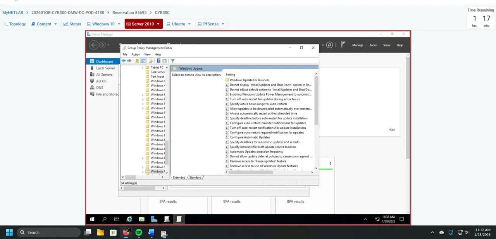

2.  Find **Configure Automatic Updates** in Setting, double click
    
    1.  Set to auto download and schedule install
    
    2.  Set schedule to every day at 7:00PM every week
    
    3.  Click OK to save
    
    4.  Close Group Policy Management console.

3.  Open command prompt or PowerShell -\> Command: **gpupdate /force**

> 
> 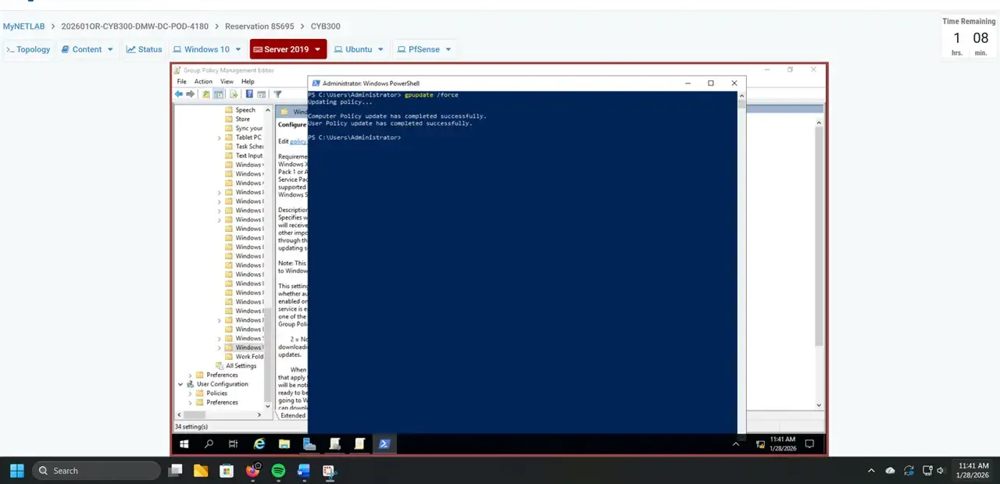

4.  Run command prompt or PowerShell as Administrator
    
    1.  > Type **gpresult**
    
    2.  > Expand **Computer Configuration** section
    
    3.  > Take screenshot showing settings have applied successfully

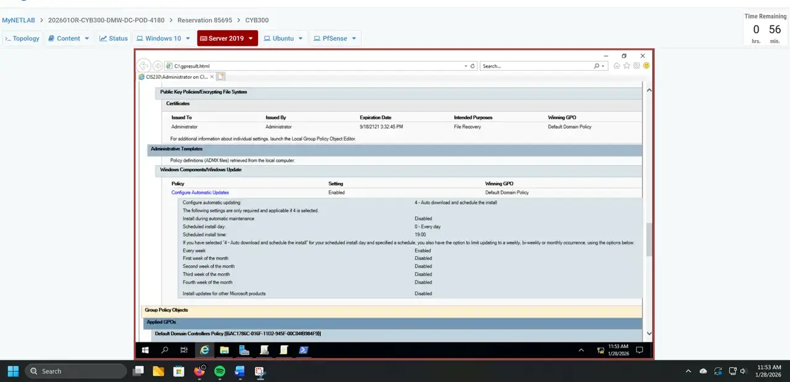

**Audit Policy Remediation**

1.  Edit current **Audit** settings on system Windows Server 2019
    
    1.  Go to **Server Manager** -\> **Tools** -\> **Group Policy Management**
    
    2.  Expand tree two levels -\> Right-click on **Default Domain Policy** -\> **Edit**
    
    3.  Expand **Computer Configuration - Policies** section
    
    4.  Expand Windows Settings -\> Security Settings -\> Local Policies -\> Audit Policy

2.  Enable auditing for all listed event types – Right click, select Properties – check all boxes, click OK.

> 
> 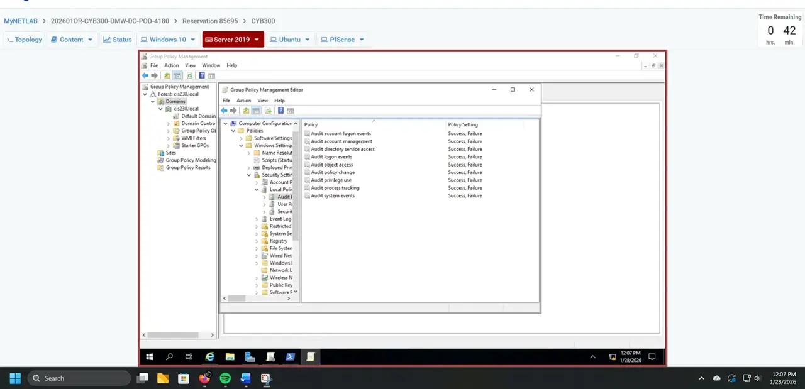

3.  Close Group Policy Management Editor and Console

4.  Open command prompt or PowerShell -\> Command: **gpupdate /force**

**Linux OS Execution Plan**

**Enable Automatic Updates in Ubuntu**

1.  **Update Ubuntu package lists and install pending updates:**
    
    1.  Open terminal window
    
    2.  sudo apt-get update
    
    3.  sudo apt-get upgrade

2.  **Install the unattended-upgrades package with apt:**
    
    1.  sudo apt-get install unattended-upgrades

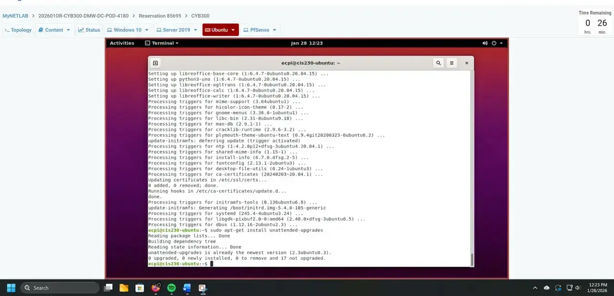

3.  **Enable the unattended-upgrades function**
    
    1.  sudo dpkg-reconfigure --priority=low unattended-upgrades

> 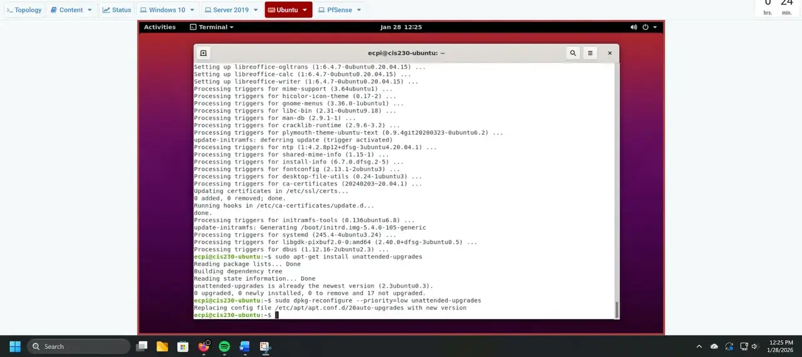

2.  When prompted to automatically install stable updates, select YES

4.  **Verify unattended upgrade service is working:**
    
    1.  sudo unattended-upgrades --dry-run (2 dashes)

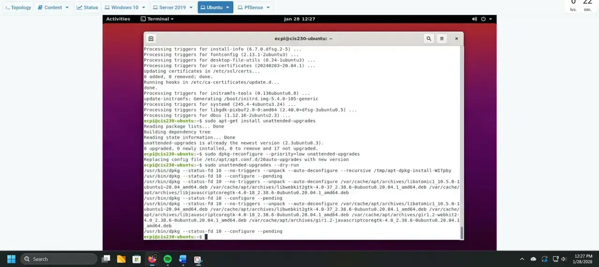

5.  **Check Unattended Upgrades Log:**
    
    1.  tail -n 100 /var/log/unattended-upgrades/unattended-upgrades.log

> 
> 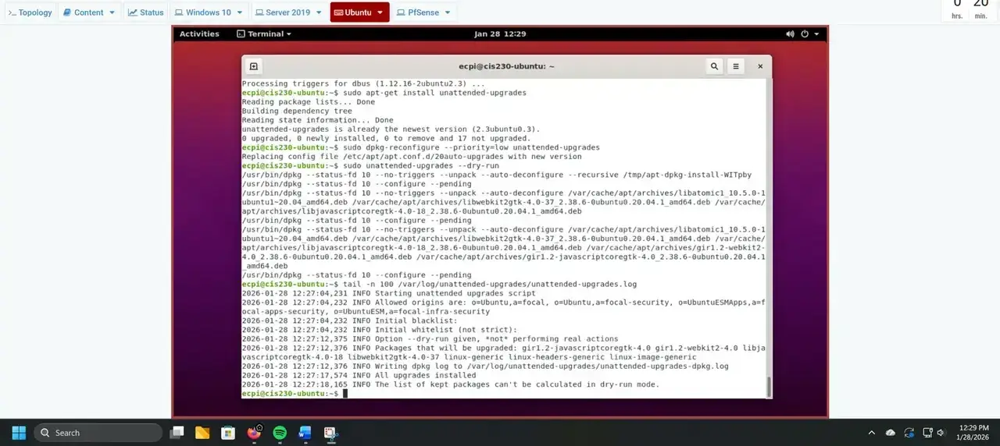

**Enable and configure Auditd for security events**

1.  **Install and configure auditd:**
    
    1.  sudo apt install auditd audispd-plugins
    
    2.  sudo systemctl --now enable auditd (2 dashes)

2.  **Set the parameter on your bootloader to enable during bootup**
    
    1.  sudo nano /etc/default/grub
        
        1.  Find the **GRUB\_CMDLINE\_LINUX=”“**command line
        
        2.  Change value to: GRUB\_CMDLINE\_LINUX=”**audit=1″**
        
        3.  Save and close Nano **- Ctrl o, Ctrl x**
    
    2.  sudo update-grub

**Windows Post-Execution and deliverables**

1.  **Log on to Server 2019 as administrator**

4.  **Log onto Window 10 client as a domain admin**

5.  Run command prompt or PowerShell as Administrator
    
    1.  Type **rsop.msc**
    
    2.  Expand **Computer Configuration** section
    
    3.  Take screenshot showing settings have applied successfully

> 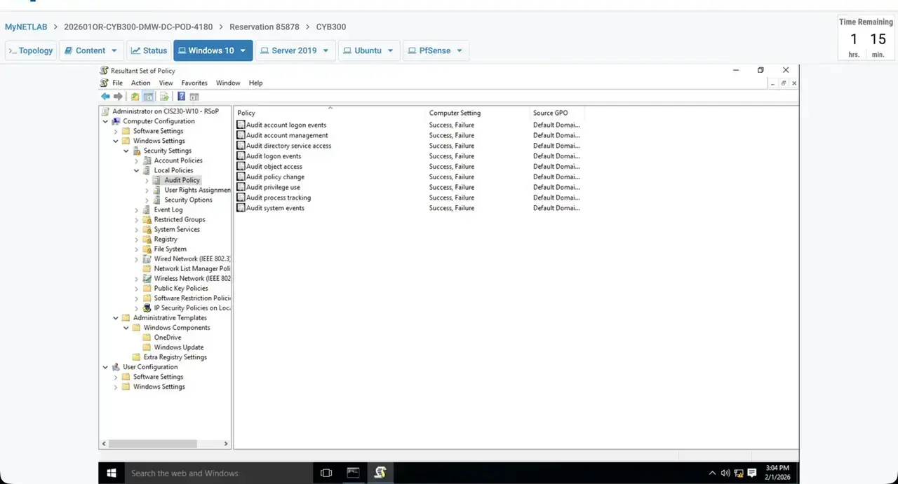
> 
> 

**Linux Post-Execution and deliverables**

1.  Log on to Ubuntu

> 

4.  Screenshot of log entries
    
    1.  tail -n 100 /var/log/unattended-upgrades/unattended-upgrades.log
    
    2.  tail -n 100 /var/log/audit/audit.log

> 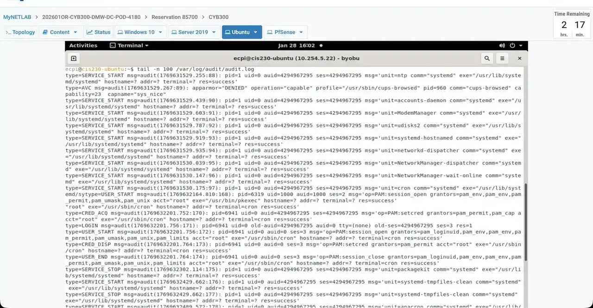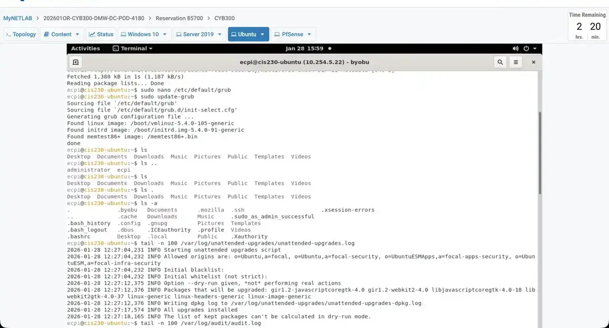

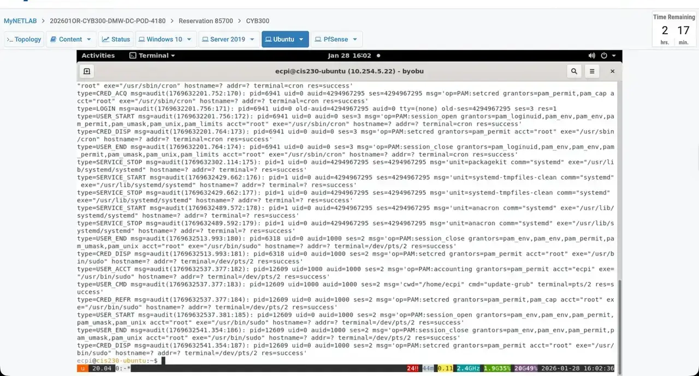**  
**

**Progress Summary**

*Update your project implementation plan here with a summary of results and related audit findings that were remediated in this assignment.* **Use these system code abbreviations: LR – Linux Risk, WR – Windows Risk, FR – Firewall Risk.  
  
**The week 1 remediation efforts focused on addressing critical security vulnerabilities in system auditing and update management across the organization’s infrastructure.

**WR (Windows Risk):** Automatic updates were successfully enabled and scheduled to run daily at 7:00 PM on the Windows Server 2019 system via Group Policy Management. The Windows audit policy was also remediated by enabling all event types to ensure comprehensive monitoring of system activities.

**LR (Linux Risk):** Ubuntu server vulnerabilities were addressed by installing and configuring the “unattended-upgrades” package to apply automated security patches. Additionally, “auditd” was installed and configured to start at system boot, maintaining a persistent audit trail.

**Testing and Validation:** All configuration changes were validated through post-execution procedures, including verifying applied group policies on Windows and conducting dry runs and log inspections on Linux. The environment is ready for final validation testing.

While these steps satisfy the goals of this preliminary phase, future updates will address additional components, such as FR (Firewall Risk), as indicated by the project requirements, which may involve the pfSense system that is already implemented but not yet configured. It may be beneficial to consider automating the verification of these security logs to ensure ongoing compliance without manual intervention.

**Testing Procedures**

  - Notify Validation Group environment is ready for testing. (Here, this means submitting this document)

**Back-out plan – update weekly**

**Windows System:**

1.  > Revert settings to original values

2.  > Run a **gpupdate /force**

**Linux System:**

1.  > Remove automatic update
    
    1.  > sudo apt remove unattended-upgrades

2.  > Remove auditd
    
    1.  > sudo apt remove auditd audispd-plugins

**Project Notes**

Make sure you specify the systems that you are working on configuring as part of the change management process.

Server Info:

**(Virtual) Server Name:** Ubuntu-Server-01

**OS:** Ubuntu 20.04

**IP Address:**

**Server Specs:**

VM

CPU/RAM/STORAGE/NETWORK:

2 vCPU, 2GB RAM,
