# Security Audit Remediation: Host Firewalls, DEP and pfSense Rules

**Course:** CYB300 Advanced Cybersecurity with AI · ECPI University · Mar 2026  
**Work:** Individual

## Scenario

Enabling Windows Firewall and Data Execution Prevention through GPO, configuring ufw on Linux, forwarding pfSense logs to syslog and building pfSense rules for Active Directory traffic, each with testing procedures.

## Skills and tools

- **Skills:** Firewall configuration, GPO hardening, Log forwarding, Network segmentation
- **Tools and references:** pfSense, ufw, Group Policy, syslog, Windows Server

## My work

*Converted from my original submission. The assignment prompt, grade and instructor feedback are not included.*

### Project Scope

***WEEK 3 Vulnerabilities to Remediate***

**Windows Server** - (Default Domain Policy) Enable Windows Firewall, allow ICMP from internal segments, enable DEP (**Data Execution Prevention**) policies (Default Domain Policy). Same on (Domain Controllers) GPO but block policy inheritance and add allow ssh from Linux to the server. Enable DEP policies (Default Domain Policy)

*Demo:* Enable DEP policies

**Linux** - Enable ufw firewall and allow only NTP from internal segments, allow SSH from Win server and client segments, allow syslog from Pfsense for firewall.

*Demo:* Allow syslog from Pfsense for firewall

**Pfsense** - (Firewall allows all traffic) Match the firewall rules configured for Windows and Linux and then research Active Directory required ports and set up firewall rules that allow both the Windows 10 client and Linux machine to access domain resources.

*Demo:* Create a firewall rule

**Marvin Castro Hernandez student01**

### Project Summary

To achieve compliance with the items discovered in the voluntary security audit, several changes are proposed to address the issues listed in the project scope. The requirements for the necessary changes have been defined and low-level details of the specific changes are listed including validation. Risk has been assessed for contingency and backout plan is defined to respond in the event of an impact.

**Preparation**

1.  Create project implementation plan per system
    
    1.  Identify pre and post execution procedures (specific changes to be made and method for validation, i.e., commands or screenshots)

2.  \*Notify Stakeholders (Peer review of changes) (Not required, for informational purposes.)

3.  \*Schedule project in scheduled maintenance calendar (Not required, for informational purposes.)

4.  Capture screenshot of current configuration and environment (i.e, make sure you’re logged into the right system)

5.  Apply changes (commands or screenshots)

6.  Document applied settings (commands or screenshots)

7.  Notify Validation Group environment is ready for testing. (Not required for informational purposes.)

8.  Summarize scope of remediated vulnerabilities with reference to the specific audit findings for Final Report.

9.  Submit completed document in Canvas.

**Windows OS Execution Plan**

**Enable DEP policies for domain**

1.  Edit current **Windows Updates** settings on system Windows Server 2019
    
    1.  Go to **Server Manager** --\> **Tools** --\> **Group Policy Management**
    
    2.  Expand tree --\> Right-click on **Default Domain Policy** --\> **Edit**
    
    3.  Expand **Computer Configuration** section
    
    4.  Policies --\> Windows settings --\> Scripts (startup / shutdown)
        
        1.  Add a command (double-click) **startup** script, browse, and select: "powershell set-execution policy unrestricted.ps1"
        
        2.  (Info only)Script has the following:

> **powershell.exe Set-ExecutionPolicy unrestricted**
> 
> **\#\#\#\#\#\#\#\#**
> 
> **bcdedit /set nx AlwaysOn**

**\#\#\#\#\#\#\#\#**

1.  Open command prompt or PowerShell --\> Command: **gpupdate /force**

**(Default Domain Policy) Enable Windows Firewall and allow ICMP from internal networks**

1.  **Enable Windows Firewall.**
    
    1.  List **all** steps
        
        1.  **Enable Windows Firewall (Default Domain Policy)**
        
        2.  a. **Open Group Policy Management:**
        
        3.  On your Domain Controller, open **Server Manager**, click **Tools**, and select **Group Policy Management**.
        
        4.  b. **Edit the Policy:**
        
        5.  Expand your **Forest** -\> **Domains** -\> **\[suspicious link removed\]**.
        
        6.  Right-click on **Default Domain Policy** and select **Edit**.
        
        7.  c. **Navigate to Firewall Settings:**
        
        8.  In the Group Policy Management Editor, navigate to: Computer Configuration -\> Policies -\> Windows Settings -\> Security Settings -\> Windows Defender Firewall with Advanced Security -\> Windows Defender Firewall with Advanced Security.
        
        9.  d. **Enable Firewall Profiles:**
        
        10. Right-click on the **Windows Defender Firewall with Advanced Security** node (the one inside the right pane) and select **Properties**.
        
        11. Click the **Domain Profile** tab -\> Set **Firewall state** to **On (recommended)**.
        
        12. Click the **Private Profile** tab -\> Set **Firewall state** to **On (recommended)**.
        
        13. Click the **Public Profile** tab -\> Set **Firewall state** to **On (recommended)**.
        
        14. Click **OK**.

2.  **Add firewall rule to allow ICMP from internal segments.**
    
    1.  List **all** steps
    
    2.  1.  **Add Firewall Rule to Allow ICMP from Internal Segments**
        
        2.  a. **Create New Inbound Rule:**
        
        3.  In the same Group Policy window, click on **Inbound Rules** in the left pane.
        
        4.  Right-click in the right pane and select **New Rule...**.
        
        5.  b. **Configure Rule Type:**
        
        6.  Select **Custom** and click **Next**.
        
        7.  Select **All programs** and click **Next**.
        
        8.  c. **Configure Protocols:**
        
        9.  For **Protocol type**, select **ICMPv4**.
        
        10. Click **Customize...** -\> Select **Specific ICMP types** -\> Check **Echo Request** (this allows Ping).
        
        11. Click **OK** and then **Next**.
        
        12. d. **Define Scope (Internal Segments):**
        
        13. Under **Which remote IP addresses does this rule apply to?**, select **These IP addresses**.
        
        14. Click **Add...** and enter your internal network segments (e.g., 192.168.1.0/24, 10.0.0.0/8, or specific subnets).
        
        15. Click **OK** and then **Next**.
        
        16. e. **Finalize Rule:**
        
        17. Select **Allow the connection** and click **Next**.
        
        18. Check **Domain**, **Private**, and **Public** (as applicable) and click **Next**.
        
        19. **Name:** Enter "Allow ICMPv4 from Internal Network".
        
        20. Click **Finish**.

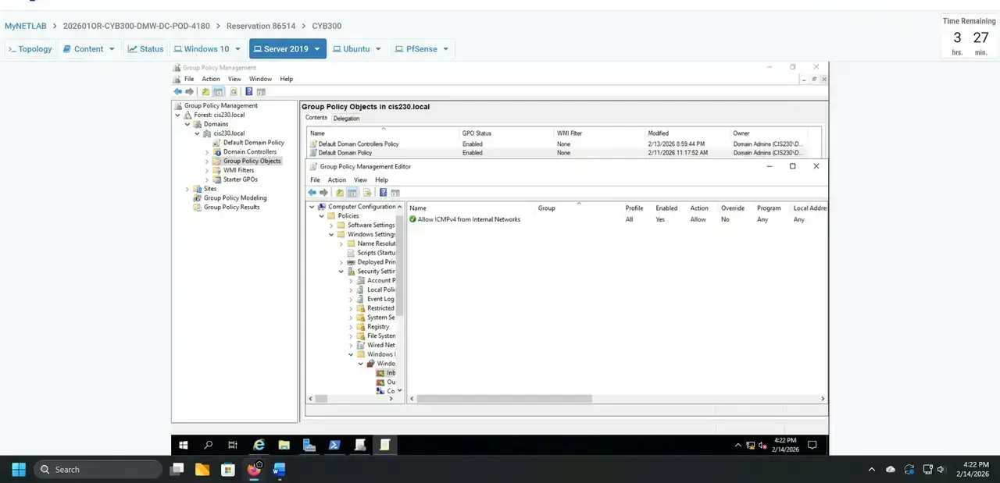

3.  **Please provide the group policy editor screenshot**

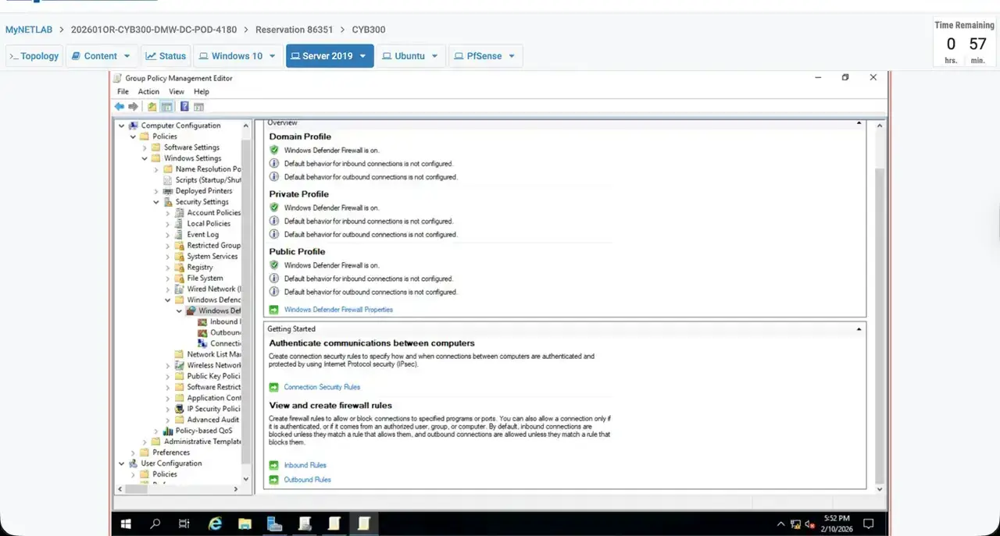

**(Default Domain Controllers Policy) Edit GPO to block policy inheritance, enable firewall, and add allow ping/ssh from Linux to the server**

1.  **Edit Domain Controllers GPO and disable inheritance –**
    
    1.  List **all** steps
        
        1.  Open **Server Manager**, click **Tools**, and select **Group Policy Management**.
        
        2.  In the left pane, expand your **Forest** -\> **Domains** -\> **\[suspicious link removed\]**.
        
        3.  Locate the Organizational Unit (OU) named **Domain Controllers**.
        
        4.  Right-click on the **Domain Controllers** OU folder itself (not the policy inside it).
        
        5.  Select **Block Inheritance** from the context menu.
        
        6.  You will see a blue circle with a white exclamation mark appear on the OU folder icon, indicating inheritance is blocked.
    
    2.  
    3.   **Provide the result screenshots**
    
    4.  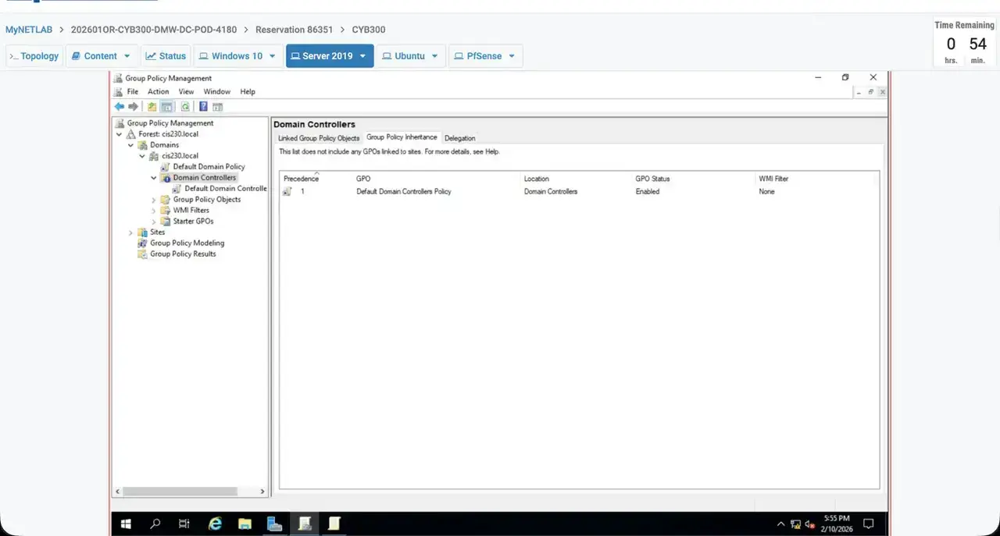

2.  **Enable DEP policy**
    
    1.  List **all** steps (will be same as for Default Domain Policy)
        
        1.  In **Group Policy Management**, expand the **Domain Controllers** OU.
        
        2.  Right-click on **Default Domain Controllers Policy** and select **Edit**.
        
        3.  Navigate to: **Computer Configuration** -\> **Policies** -\> **Windows Settings** -\> **Scripts (Startup/Shutdown)**.
        
        4.  Double-click **Startup** in the right pane.
        
        5.  Click **Add...** -\> **Browse...**.
        
        6.  Locate and select the EnableDEP.bat script you created earlier (located in C:\\Scripts\\ or similar).
        
        7.  Click **OK** twice to save and close.
    
    2.  
3.  **Enable Windows firewall settings**
    
    1.  List **all** steps
        
        1.  In the **Group Policy Management Editor** (where you are editing the Default Domain Controllers Policy), navigate to: **Computer Configuration** -\> **Policies** -\> **Windows Settings** -\> **Security Settings** -\> **Windows Defender Firewall with Advanced Security**.
        
        2.  Right-click on **Windows Defender Firewall with Advanced Security** (the top-level node in the left pane) and select **Properties**.
        
        3.  **Domain Profile Tab:** Change **Firewall state** to **On (recommended)**.
        
        4.  **Private Profile Tab:** Change **Firewall state** to **On (recommended)**.
        
        5.  **Public Profile Tab:** Change **Firewall state** to **On (recommended)**.
        
        6.  Click **Apply** and **OK**.
    
    2.  
4.  **Add firewall rules to allow icmp and ssh from Linux to Windows Server**
    
    1.  List **all** steps
        
        1.  In the same GPO Editor window, click **Inbound Rules**.
        
        2.  Right-click in the right pane and select **New Rule...**.
        
        3.  Select **Custom** and click **Next**.
        
        4.  Select **All programs** and click **Next**.
        
        5.  **Protocol type:** Select **ICMPv4**.
        
        6.  Click **Customize...**, select **Specific ICMP types**, check **Echo Request**, and click **OK**. Click **Next**.
        
        7.  **Scope:** Under **Which remote IP addresses does this rule apply to?**, select **These IP addresses**.
        
        8.  Click **Add...** and enter the specific IP address of your **Linux Machine**. Click **OK**.
        
        9.  Select **Allow the connection**, click **Next**, ensure all profiles are checked, and click **Next**.
        
        10. **Name:** Enter "Allow ICMP from Linux". Click **Finish**.

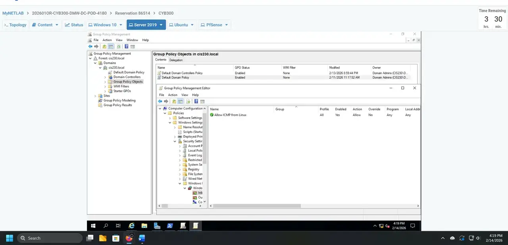

**Linux OS Execution Plan**

**Add firewall rules**

1.  **Enable Ubuntu firewall**
    
    1.  sudo ufw enable

2.  **Add rule to allow syslog traffic from the Pfsense firewall:**
    
    1.  sudo ufw allow in on em1 from 172.16.10.1/24 to 172.16.30.30 proto udp port 514 **(\*\*Change IP Address to match your network\*\***)

3.  **Add rule to lock down ssh access to only allow from Windows Server**
    
    1.  (add commands)
    
    2.  sudo ufw allow in on em1 from 172.16.10.0/24 to 172.16.30.30 proto udp port 514

4.  **Add rule to lock down ntp access to only allow from internal networks**
    
    1.  (add commands)
    
    2.  sudo ufw allow from 172.16.10.0/24 to any port 123 proto udp
    
    3.  sudo ufw allow from 172.16.20.0/24 to any port 123 proto udp
    
    4.  sudo ufw allow from 172.16.30.0/24 to any port 123 proto udp

5.  **Verify firewall rules**
    
    1.  sudo ufw status numbered – add screenshot
    
    2.  
> 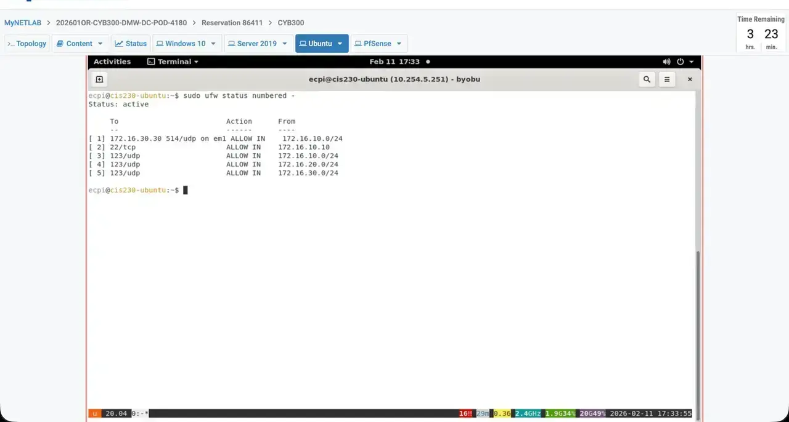

**Pfsense Firewall Execution Plan**

 **Allow ICMP between internal segments for each zone (REPEAT 3 TIMES and provide screenshot for each)**

1.  Firewall --\> Rules --\> Click on LAN1/LAN2/LAN3 --\> Click on Add with down arrow
    
    1.  Action: Pass
    
    2.  Interface: LAN1 em1 - LAN2 em2 - LAN3 em3
    
    3.  Protocol: ICMP
    
    4.  ICMP Subtypes: Select Echo Reply and Echo Request
    
    5.  Source: Network 172.16.0.0/22
    
    6.  Destination: Interface: LAN1- 172.16.10.1 - LAN2 - 172.16.20.1 -LAN3 172.16.30.1
    
    7.  Extra Options/Log: Check box for “Log packets that are handled by this rule”
    
    8.  Click Save at the bottom

**Add firewalls rules to lock down access between network segments**

1.  Firewall rule(s) allow traffic from Windows Server to Window 10 Client
    
    1.  Research is required for these firewall rules
    
    2.  Check Microsoft resources for required ports for Active Directory

2.  Firewall rule allowing traffic from Windows 10 Client to Windows Server
    
    1.  Research is required for these firewall rules
    
    2.  Check Microsoft resources for required ports for Active Directory

3.  Firewall rule(s) allowing traffic from Linux to Windows Server
    
    1.  Permit ports required for Active Directory
    
    2.  Permit HTTPS

4.  Firewall rule(s) allowing traffic from Windows Server to Linux
    
    1.  Permit ports required for Active Directory
    
    2.  Permit SSH
    
    3.  Permit NTP

5.  Firewall rule allowing traffic from Windows 10 Client to Linux
    
    1.  Permit NTP
    
    2.  Permit ports required for Windows/Samba shares (research for answer)

6.  **Three screenshots: Windows Server, Windows Client, and Linux.**

**  
**

**Windows Post-Execution and deliverables**

1.  For the server show screenshots of all group policy settings that were changed

2.  Log onto Windows 10 client and run command prompt or PowerShell as Administrator
    
    1.  Type **rsop.msc**
    
    2.  Expand **Computer Configuration** section
    
    3.  Take screenshots showing all settings made on the server have applied successfully

3.  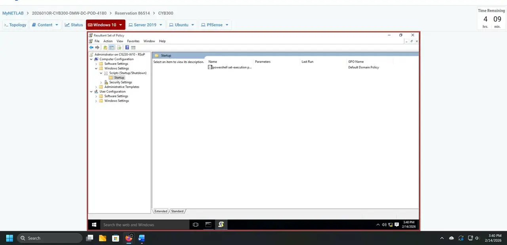

4.  **Screenshot of RSOP Startup Script**

**Linux Post-Execution and deliverables**

1.  Screenshots of all configuration changes made through the CLI

2.  Screenshot showing firewall status and rules
    
    1.  sudo ufw status numbered

3.  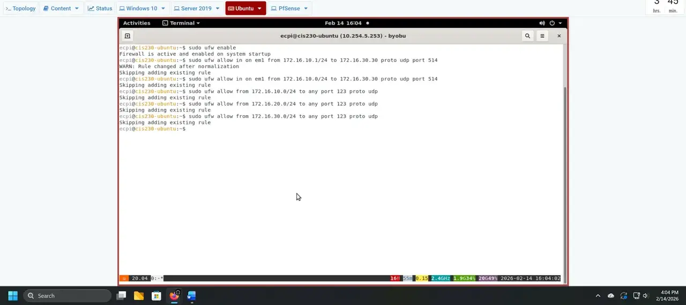

**Pfsense Firewall Post-Execution and deliverables**

1.  Screenshots of firewall configurations

2.  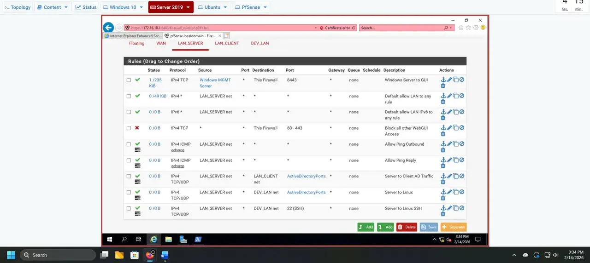

3.  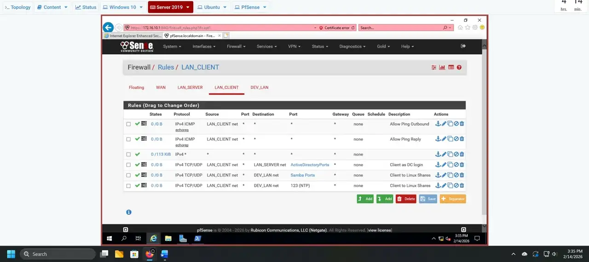

4.  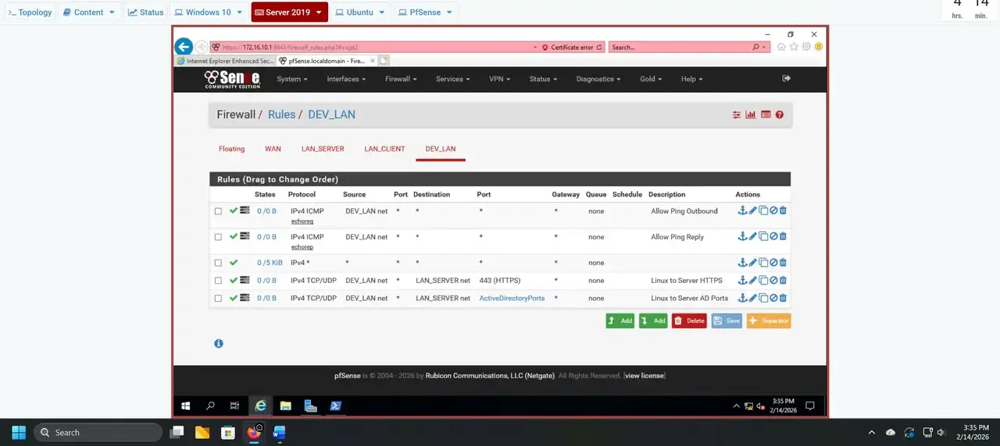

5.  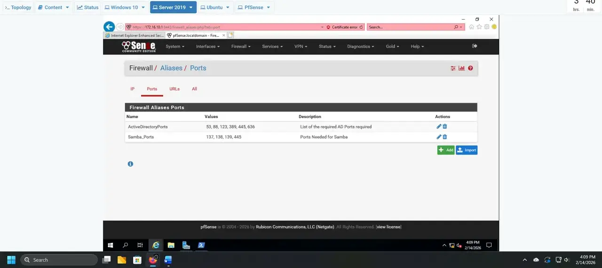

6.  
### Testing Procedures

  - Notify Validation Group environment is ready for testing.

### Back out plan: revise each week as necessary. List steps, do not execute

**Windows Server:**

1.  > **Step 1: Revert Default Domain Policy**
    
    1.  > Open **Group Policy Management** (gpmc.msc).
    
    2.  > Right-click **Default Domain Policy** -\> **Edit**.
    
    3.  > Navigate to **Computer Configuration** -\> **Policies** -\> **Windows Settings** -\> **Security Settings**.
    
    4.  > **Windows Firewall:** Revert all profiles (Domain, Private, Public) to **Not Configured**.
    
    5.  > **Startup Scripts:** Navigate to **Scripts (Startup/Shutdown)**, remove the EnableDEP.bat script.
    
    6.  > **ICMP Rule:** Delete the "Allow ICMPv4 from Internal Network" inbound rule.

2.  > **Step 2: Revert Domain Controllers Policy**
    
    1.  > In **Group Policy Management**, locate the **Domain Controllers** OU.
    
    2.  > **Unblock Inheritance:** Right-click the **Domain Controllers** OU and uncheck **Block Inheritance** (the blue exclamation mark icon should disappear).
    
    3.  > Right-click **Default Domain Controllers Policy** -\> **Edit**.
    
    4.  > Remove the manually added **EnableDEP** startup script.
    
    5.  > Delete the "Allow ICMP from Linux" and "Allow SSH from Linux" firewall rules.

3.  > **Step 3: Apply Changes**
    
    1.  > Open **Command Prompt** (Admin).
    
    2.  > Run the force update command: gpupdate /force
    
    3.  > Reboot the server to clear memory-resident DEP settings.

**Linux System:**

1.  > **Step 1: Disable UFW**
    
    1.  > Open **Terminal**.
    
    2.  > Run the disable command:
    
    3.  > sudo ufw disable
    
    4.  > Verify status is "inactive":
    
    5.  > sudo ufw status

**Pfsense System:**

**Revert configuration to previous version**

1.  **Step 1: Access Diagnostics**
    
    1.  > Log into the **Pfsense Web GUI**.
    
    2.  > Navigate to **Diagnostics** -\> **Backup & Restore**.
    
    3.  > Click on the **Config History** tab.

2.  **Step 2: Restore Configuration**
    
    1.  > Locate the configuration timestamped *before* the remediation execution (look for the "Remediation Plan Start" note if you made one, or the date/time prior to adding the ICMP/AD rules).
    
    2.  > Click the **Revert** icon (circular arrow) next to that entry.
    
    3.  > Confirm the action when prompted. The firewall will reload the old ruleset and may reboot.

3.  **Step 3: Verification**
    
    1.  > Verify that the newly created rules (LAN1/LAN2/LAN3 ICMP & AD) are gone.
    
    2.  > Ensure internet connectivity is still functional.

**Project notes  
**Make sure you specify the systems that you are working on configuring as part of

the change management process.

Server Info:

**(Virtual) Server Name:** Ubuntu-Server-01

**OS:** Ubuntu 20.04

**IP Address:**

**Server Specs:**

VM

CPU/RAM/STORAGE/NETWORK:

2 vCPU, 2GB RAM,
