# Enterprise Network Build: Routing, Switching and Firewall Design (team project)

**Course:** CYB330L Network Routing and Switching Lab · ECPI University · Apr 2025  
**Work:** Team project (classmates’ names removed)

## Scenario

A two-person project that designed and built a multi-site enterprise network in Packet Tracer, configuring routers, switches and firewalls and documenting the build in weekly journals.

## Skills and tools

- **Skills:** Network design, Routing and switching, Firewall placement
- **Tools and references:** Cisco Packet Tracer, OSPF, VLANs, ACLs

## My work

*Converted from my original submission. The assignment prompt, grade and instructor feedback are not included.*

**1.5 Assignment: Project Journal Part 1**

**1.5 Assignment: Project Journal Part 1**

This week, I assisted in designing the logical network topology that I created in Packet Tracer. I also created the original network and the Orlando network topology. My tasks included configuring routers, switches, and firewalls.

This week, we didn’t encounter any obstacles while configuring and diagramming the network.

Diagram of the intended Topology:

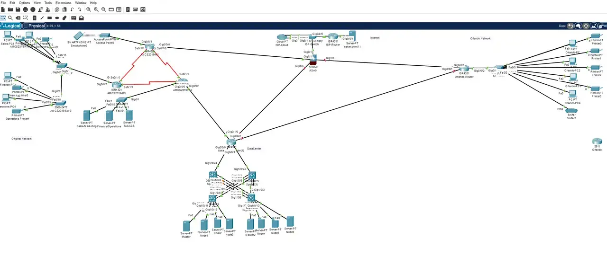

Legal and Ethical Considerations: We both ensured that it complied with the best practices for data protection. We also considered the ethical considerations of the network structure to avoid any vulnerability that could be exploited, such as the old Data Center, which didn’t have a spine and leaf architecture implemented.

We have both considered and implemented port security on the switches. We will also implement encrypted passwords on the routers so that only authorized personnel have access. We have discussed implementing firewall rules as they are the first line of defense in the network. Each router will also have Access Control Lists to ensure the best security practices.

The progress and quality of the project is going well. The logical topology is nearly complete, with the proposed merging of the Chicago network still being accounted for. Our security policies still need further configuration and refinement before deployment. Overall, the project is progressing at a steady pace. Next week, we will focus on security hardening and further configuration to ensure network connectivity.

---

**2.3 Assignment: Project Journal Part 2**

I designed the network topology, considering segmentation and security. I configured routers, switches, and the firewall to ensure connectivity and security. I set up the TACACS+ server so that the routers and switches require authentication for access. I also implemented a Syslog server for network monitoring. I conducted robust testing to ensure the network's functionality.

The main difficulty that I had was configuring the firewall. This was difficult at first because when traffic was passing through the firewall, it kept getting dropped, and I didn’t know about the default security levels. This had me troubleshooting and reconfiguring the firewall for several days. Alas, I figured it was the issue of traffic going to the least privileged interfaces. This was helpful in the end because I learned about the configuration of DMZ in firewalls.

Another big hurdle I experienced was ensuring device connectivity when using Open Shortest Path First (OSPF). I tried implementing multiple OSPF zones for device connectivity but could not reach the internet server. I tried to implement the redistribution of the border gateway protocol to OSPF within the firewall since I had OSPF connectivity within the internal network. You cannot redistribute BGP into OSPF within the firewall in Cisco Packet Tracer. The simple work around this is to utilize internal BGP or iBGP. However, Cisco Packet Tracer has limited capabilities and doesn’t support iBGP. Due to this, I opted to use an enhanced interior gateway routing protocol (EIGRP) for the network routing.

The network's security follows relevant regulations and industry standards. I also implemented strict access controls to prevent unauthorized access to network devices.

The security considerations I used and implemented were encrypted passwords on routers and switches. I also implemented access control lists to restrict traffic within the network and to prevent outside traffic from going in. I implemented a TACACS+ server that ensures only authorized users can access the network. I enabled real-time sys logging on the servers to monitor network connectivity. The switches are configured to have port security via Mac addresses so no one can jack in and gain access. I rigorously tested the firewall rules during the testing and implementation phase to ensure that only allowed traffic could pass through. Unfortunately, some network technicians didn’t show up to work, and the data center has not been configured.

Screenshots of progress on Project

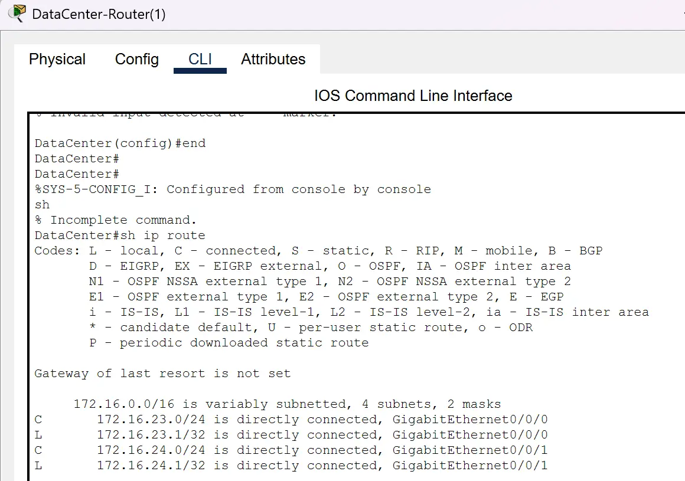

Screenshot of missing routes on DataCenter

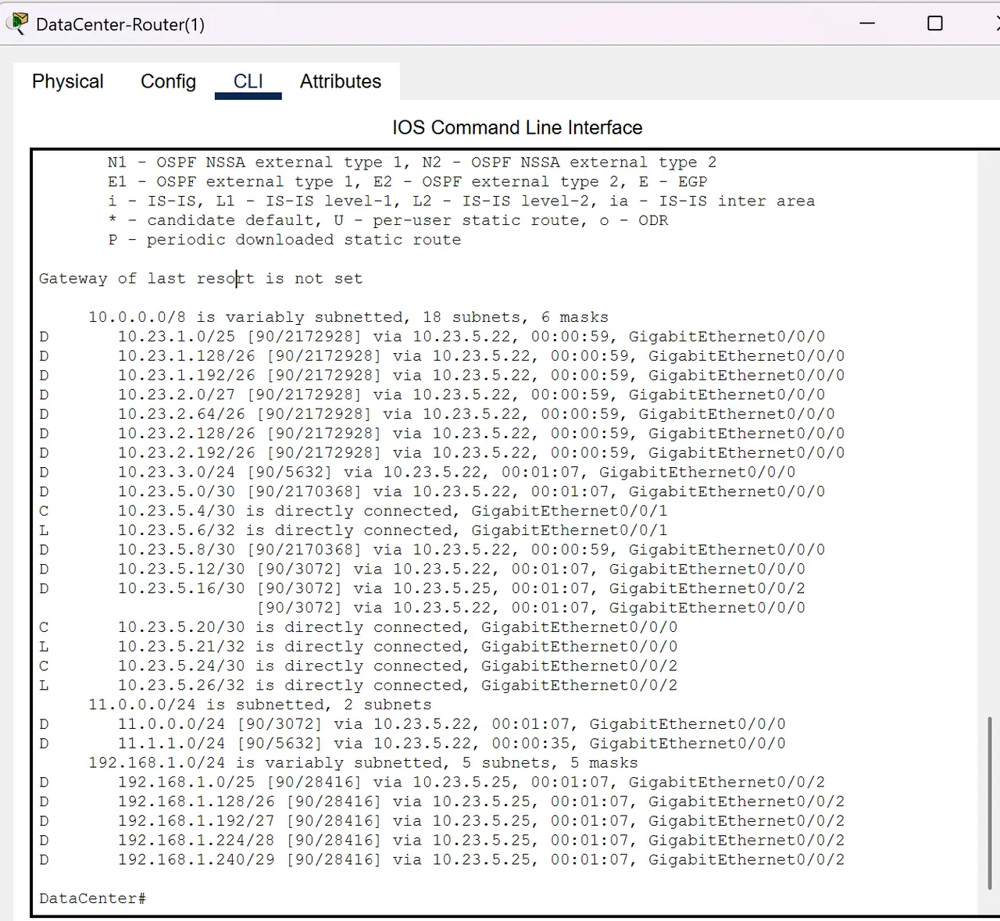

Screenshot of properly configured Routes on DataCenter Router

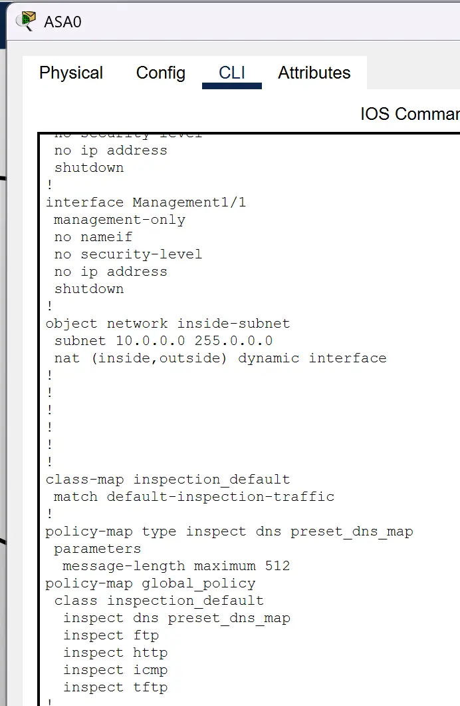

Screenshot of missing firewall configuration

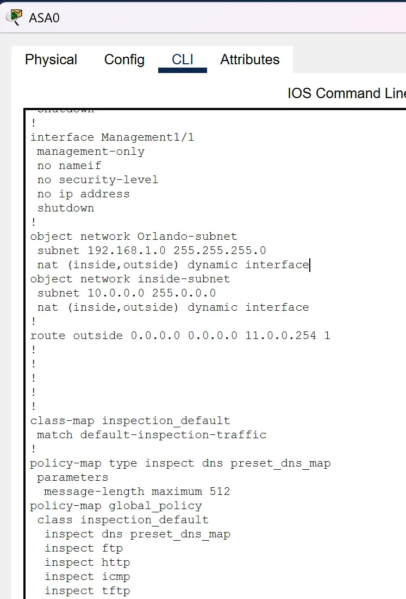

Screenshot of properly configured firewall configuration.  
  
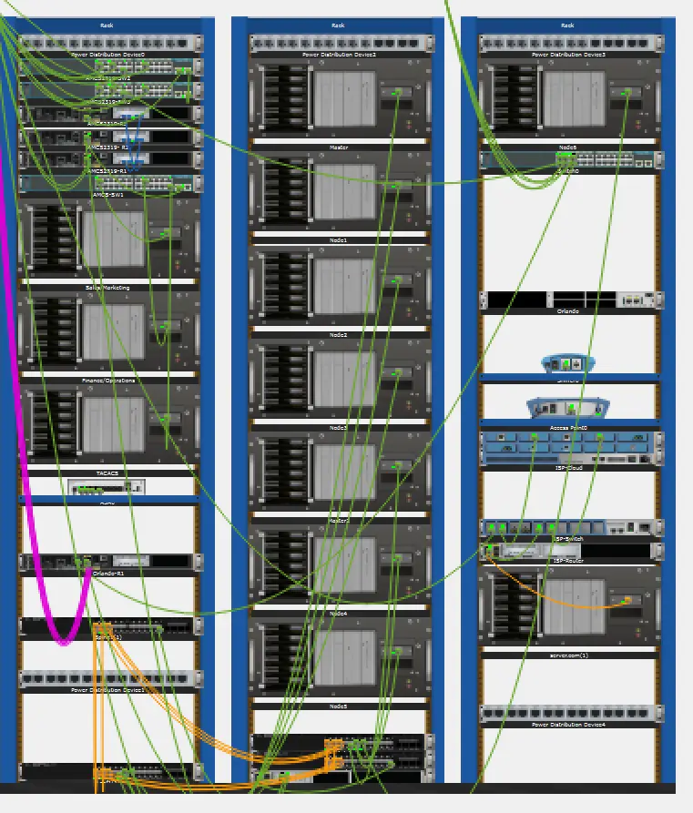  
Screenshot of Rack Room

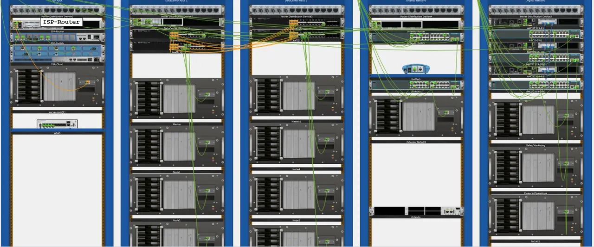

Screenshot of organized Rack Room.

---

**3.3 Assignment: Project Journal Part 3**

**3.3 Assignment: Project Journal Part 3**

This week, I contributed to making a non-technical presentation. The presentation was as expected, but the obstacle I encountered was finding the implementation costs of a network. Since this was a non-technical presentation, I used various estimations. I mainly used the National Institute of Standards and Technology (NIST) as a resource. The NIST is an amazing resource because it uses industry standards. The considerations that I had relating to security were access security. This week, I also initiated the implementation of the Chicago network. I think the progress of the project is coming nicely, and the main obstacle in the future will be the technical presentation.

**References**

National Institute of Standards and Technology. (2024). The NIST Cybersecurity Framework (CSF) 2.0. *The NIST Cybersecurity Framework (CSF) 2.0*, *2.0*(29). https://doi.org/10.6028/nist.cswp.29

NIST. (2022). Assessing Security and Privacy Controls in Information Systems and Organizations. *Assessing Security and Privacy Controls in Information Systems and Organizations*, *5*. https://doi.org/10.6028/nist.sp.800-53ar5

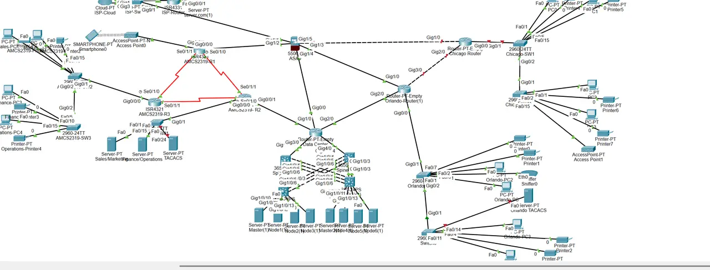

---

**4.3 Assignment: Project Journal Part 4**

**4.3 Assignment: Project Journal Part 4**

This week, I played a crucial role in enhancing and configuring network security. I ensured that the firewall rules and policies restricted unauthorized traffic while allowing legitimate traffic. I implemented a demilitarized zone (DMZ) so that the firewall passes traffic through the highest security level to the lowest security level. I also configured extended Access Control Lists (ACLs) on all routers so that only authorized traffic can communicate with each other. This is to ensure that if an unauthorized user gains access, it will be more challenging for them to leapfrog onto other networks. I also implemented a Terminal Access Controller Access-Control System Plus (TACACS+). This provides a central command center for authentication, authorization, and accounting (AAA).

The issues and obstacles I encountered included conflicting firewall rules, which caused connectivity problems. This issue was resolved by configuring the Network Address Translation (NAT) to allow internal communication. I also experienced difficulties pinging the internet server when configuring the skeleton network. Everyone else also encountered issues with this as well. I suspect someone tampered with the server settings to sabotage the class.

The legal and ethical considerations involved in implementing the TACACS+ server require users to be authenticated before gaining access to the network. This was done to ensure compliance with all cybersecurity guidelines and best practices as defined by the National Institute of Standards and Technology (NIST). I have also implemented authorization policies so that only authorized personnel can modify firewall or ACL rules. Following guidelines and regulations, the organization maintains logs for accountability in the TACACS.

The security considerations were encryption of stored passwords in routers and TACACS. This is to ensure that no one gains access to the passcodes, thereby preventing unauthorized modification of any devices. TACACS also ensures that users have only the minimum necessary permissions to perform their tasks.

The project's progress is going reasonably well. This was week four, and the entire network had been configured and aligned with cybersecurity requirements. The end devices can ping the internet server and have implemented strict ACLs and firewall configurations to allow only explicitly permitted traffic.

**Documentation of Packet Tracer**

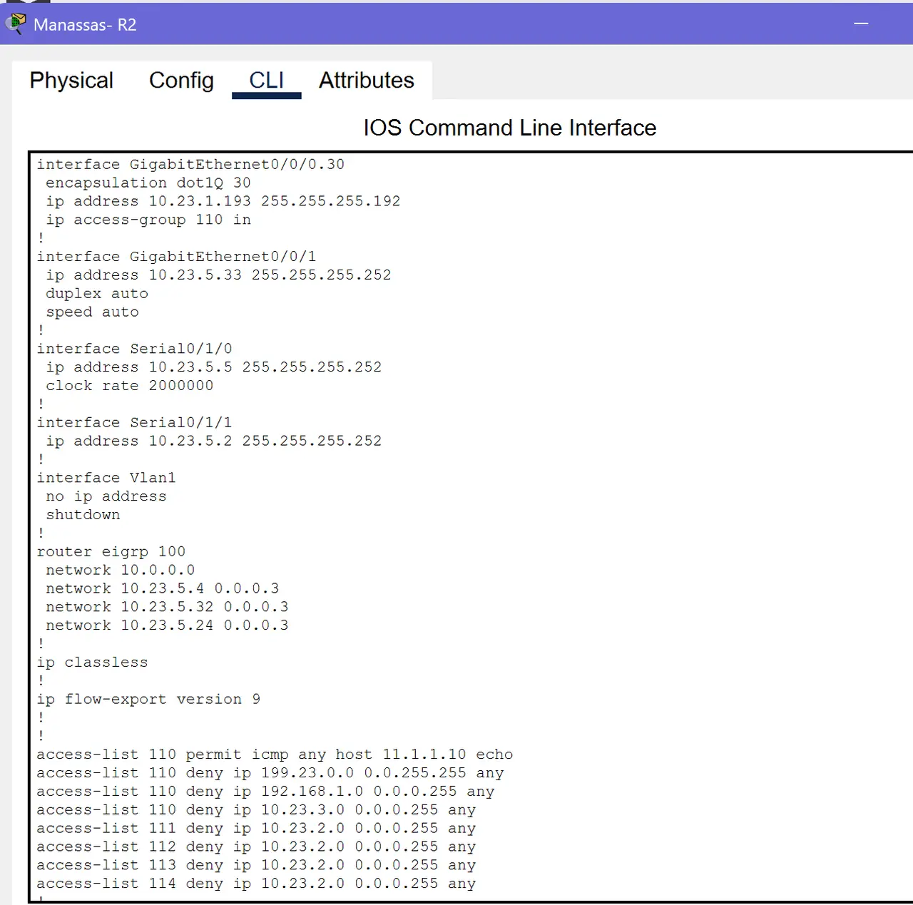

**Screenshot of ACLs on Router 2**

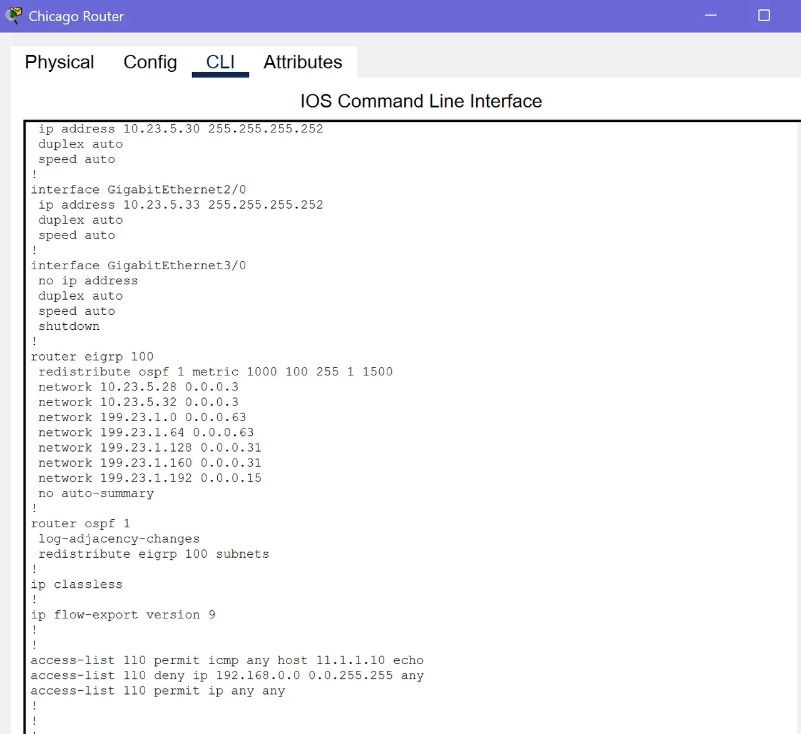

**Screenshot of config on Chicago Router**

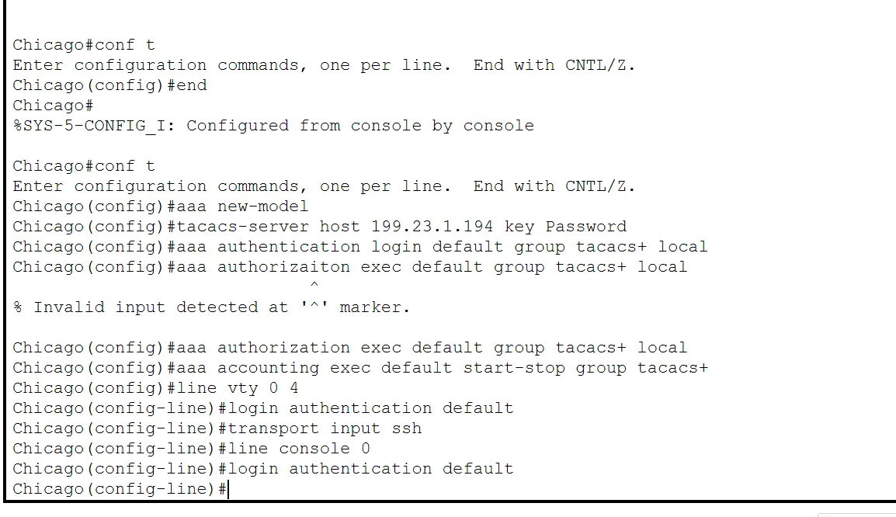

**Screenshot of TACACS and logging on Chicago Router**

**  
**

**Documentation of Skeleton Network**

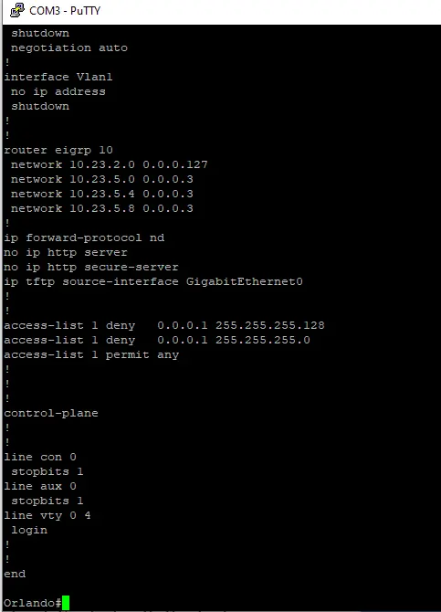

**Screenshot of config of Orlando Router and ACLs**

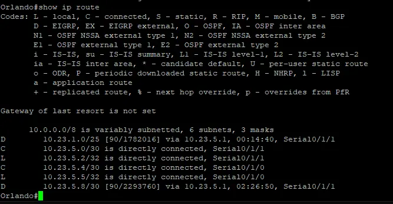

**Routing Table Orlando Routers**

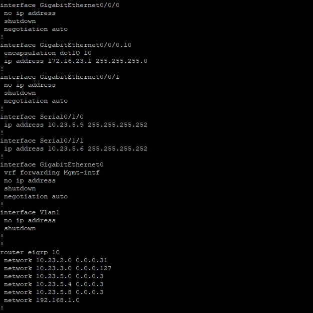

**DataCenter Config**

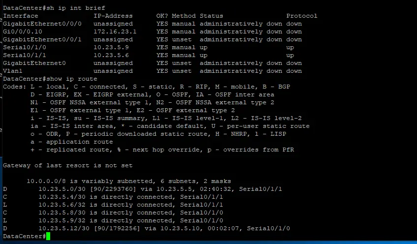

**DataCenter Routing Table**

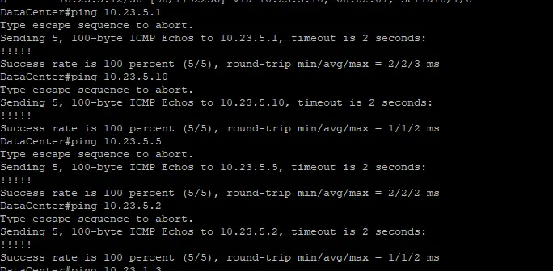

**Ping to Internal Network**

---

**5.3 Project: Final Project Submission**

**5.3 Project: Final Project Submission**

The key consideration in this final project was to create and establish an infrastructure network that focuses on efficiency, scalability, and resilience. The E-MAGIZE client required a secure network backbone to support daily operations, secure data processing, and future expansion.

I created an end-to-end network topology using Cisco devices that incorporated dynamic routing protocols, centralized access control, and policy-based security capabilities. For the design, I utilized EIGRP, OSPF, and BGP, along with route redistribution, to provide end-to-end connectivity between separate domains within the network. Ethical and security issues were also considered in the network design to ensure alignment with NIST (National Institute of Standards and Technology) standards, thereby maintaining data integrity, confidentiality, and availability.

EIGRP (Enhanced Interior Gateway Routing Protocol) was introduced in internal domains to support fast convergence, unequal cost load distribution, and minimum administrative overhead. BGP (Border Gateway Protocol) was also configured on the edge of the network to simulate ISP and institution-to-institution connectivity, enabling the infrastructure to expand beyond a single administrative domain.

By implementing route redistribution between EIGRP and BGP, I achieved interoperability among the different routing protocols—a critical requirement for accommodating future expansion and mergers with other external networks. Redundant paths and multiple routers were implemented to maintain network availability even in the case of a node or link failure. This was tested using various link-down scenarios. The dynamic routing protocols in use are known to support faster convergence and network self-healing capabilities, thereby enhancing resilience.

**Security and Ethical Considerations**

I installed TACACS+ (Terminal Access Controller Access Control System Plus) to authenticate and authorize network administrators centrally, given its critical relevance to network security. This provides auditing with comprehensive details and strict access control.

**What I Was Able to Deliver**

Configured a multi-protocol environment of EIGRP and BGP successfully. Established route redistribution to support end-to-end communication between different routing domains. Implemented redundant topologies to create fault tolerance and facilitate quick failover. Integrated TACACS+ to enable secure and centralized administrative control. Implemented NIST security best practices in an ethical and policy-driven manner.

Although the fundamental aims were met, multiple real-world implementations proved to be limited by Packet Tracer’s restricted functionality. Basic BGP functionality only is supported. Packet Tracer does not support BGP redistribution through the firewall, which is crucial in a network scenario. TACACS+ Redundancy also isn’t supported, while Packet Tracer only gives basic TACACS+ functionality. I was able to set up simple security implementations, but they do not accommodate threat simulation, intrusion detection and prevention systems (IDS/IPS), nor advanced encryption methods.

In summary, the project fulfilled the customer's requirement by providing an efficient, robust, and scalable network infrastructure. Although the simulation platform had some limitations, I successfully demonstrated key concepts in enterprise networking, including interoperability between protocols, centralized access control, and compliance with cybersecurity standards. The implementation aligns with real-world design principles and is well-positioned for deployment.

**References**

National Institute of Standards and Technology. (2024). The NIST Cybersecurity Framework (CSF) 2.0. *The NIST Cybersecurity Framework (CSF) 2.0*, *2.0*(29). https://doi.org/10.6028/nist.cswp.29

NIST. (2022). Assessing Security and Privacy Controls in Information Systems and Organizations. *Assessing Security and Privacy Controls in Information Systems and Organizations*, *5*. https://doi.org/10.6028/nist.sp.800-53ar5

---

**5.3 Project: Final Project Submission Inventory list**

**5.3 Project: Final Project Submission Inventory list**

Inventory of Network Devices and Equipment

| Device                    | Quantity | Description                                                                      | Estimated Unit Price (USD) | Total Estimated Cost (USD) |
| ------------------------- | -------- | -------------------------------------------------------------------------------- | -------------------------- | -------------------------- |
| Cisco ASA 5506-X Firewall | 1        | Entry-level next-generation firewall for small to medium-sized networks.         | $600                       | $600                       |
| Cisco ISR4321 Routers     | 6        | Integrated Services Routers designed for secure, scalable enterprise networks.   | $1,100                     | $6,600                     |
| Cisco 2960 Switches       | 7        | Layer 2 switches for access-layer deployments with basic LAN services.           | $800                       | $5,600                     |
| Cisco 3650 Switches       | 4        | Layer 3 switches with advanced routing and stacking capabilities.                | $2,500                     | $10,000                    |
| Enterprise Servers        | 11       | High-performance servers for hosting applications and managing network services. | $3,000                     | $33,000                    |
| Work PCs                  | 300      | Standard desktop computers for staff and administrative use.                     | $700                       | $210,000                   |
| Work Printers             | 150      | Office printers for document printing and scanning.                              | $200                       | $30,000                    |
| Work Laptops              | 50       | Portable computers for staff requiring mobility.                                 | $900                       | $45,000                    |

Total Estimated Inventory Value: $340,800

---

##### Slide 1

- Network ImplementationBridging Technical Design with Business Understanding
- By: Marvin Castro Hernandez

##### Slide 2

- Introduction

##### Slide 3

- Network Design Overview
- What does a network do?
  - A network ensures that all employees, departments, and locations can communicate.
  - It ensures fast, reliable, and, most importantly, secure communication
  - Supports critical business applications such as email and file sharing

##### Slide 4

- Key Features
  - The network has been designed to be scalable which means it can expanded upon as the company grows
  - The network is secure, which means sensitive data is protected from cyber threats

##### Slide 5

- Rationale for Design Decisions

##### Slide 6

- Potential Risks and Mitigation

> Speaker notes: Advanced Firewalls - which is a network security device that inspects and controls incoming and outgoing traffic Password Encryption – is the process of protecting data by using mathematical models to scramble it

##### Slide 7

- Implementation Costs

- Initial Setup Costs
  - Hardware: Routers, Switches, Servers and Cabling
  - Software: Licenses for network management and security tools
  - Installation: Labor costs for setup and configuration
- Ongoing Maintenance Costs
  - Updates: Regular software patches and upgrades
  - Support: IT staff and external consultants for troubleshooting
  - Upgrades: Future-proof the network as technology evolves

##### Slide 8

- Initial Setup Costs
  - Hardware- $25,000 - $50,000
  - Software Licenses $20,000 – $40,000
  - Installation - $15,000 - $30,000
  - Total initial costs - $60,000 - $150,000
- Ongoing Maintenance Costs
  - Software Updates - $5,000 - $10,000
  - IT Support - $50,000 - $100,000
  - Hardware Upgrades $10,000 - $20,000
  - Total Annual Costs- $45,000 - $100,000

##### Slide 9

- Implementation Plan

##### Slide 10

- Benefits of the Network

##### Slide 11

- Conclusion

##### Slide 12

- References
- National Institute of Standards and Technology. (2024). The NIST Cybersecurity Framework (CSF) 2.0. The NIST Cybersecurity Framework (CSF) 2.0, 2.0(29). https://doi.org/10.6028/nist.cswp.29
- NIST. (2022). Assessing Security and Privacy Controls in Information Systems and Organizations. Assessing Security and Privacy Controls in Information Systems and Organizations, 5. https://doi.org/10.6028/nist.sp.800-53ar5

##### Slide 13

- Questions?

---

##### Slide 1

- Enterprise Design: Security, Scalability, and Resilience
- April 3rd, 2025

> Speaker notes: Good morning, and thank you for joining today’s deep dive into modern network architecture. We’ll explore how to build a network that’s secure against evolving threats, scalable enough to grow with your organization, and resilient enough to withstand failures. Our focus will include firewalls with NAT for perimeter defense, EIGRP and BGP redistribution to unify complex networks, TACACS+ for ironclad access control, and port-security to lock down physical access points. By the end, you’ll understand not just what these components do, but how they work together and why they’re critical in today’s digital landscape. Let’s start with the objectives driving this design."

##### Slide 2

- Core Objectives

> Speaker notes: Let’s break down these objectives. Security isn’t just about blocking attacks—it’s about layers. For example, NAT hides internal IP addresses, making it harder for attackers to map your network. TACACS+ ensures that even if credentials are stolen, attackers can’t execute destructive commands without authorization.  Scalability means designing for growth. If your company acquires another business using OSPF, EIGRP redistribution allows seamless integration without reconfiguring the entire network.   Resilience is about staying online. Imagine a fiber cut disables your primary ISP link—BGP’s fast convergence reroutes traffic in milliseconds, avoiding downtime.   Finally, efficiency ensures resources aren’t wasted. Dynamic routing protocols like EIGRP automatically find the fastest paths, while monitoring tools like NetFlow pinpoint bandwidth hogs.

##### Slide 3

- Network Architecture Overview
- Key Components
  - Perimeter Security – Next-generation appliances for traffic inspection
  - AAA framework – TACACS+ for device administration (Terminal Access Controller Access Control System Plus)
  - Data Center Architecture – Spine-Leaf for low-latency traffic
  - Monitoring – NetFlow, SIEM, and packet capture tools

> Speaker notes: Let’s walk through the architecture layer by layer.   At the perimeter, next-gen firewalls perform NAT to mask internal IPs and inspect encrypted traffic for hidden threats.   Behind this, the core layer acts as the network’s backbone. Here, EIGRP dynamically redistributes routes from OSPF branches, BGP clouds (like AWS), and legacy static networks, creating a unified routing table.   At the access layer, switches enforce port-security, ensuring only authorized devices can connect. For example, a hospital might bind ICU device MAC addresses to specific ports, preventing unauthorized laptops from plugging in. Finally, monitoring tools like SIEM correlate data across layers. If a firewall rule is changed at 2 AM, SIEM cross-references TACACS+ logs to see which admin made the change—turning raw data into actionable insights

##### Slide 4

##### Slide 5

- Firewalls – Beyond the Basics
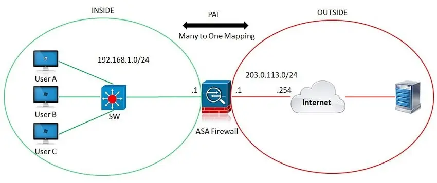
- (Sharma, 2025)

> Speaker notes: Let’s demystify NAT. Static NAT is like a dedicated phone line—exposing a server’s private IP to the public. However, static NAT does not provide anonyminity since the same public IP is used for a particular host.   PAT (Port Address Translation) is the real workhorse. The firewall maps each internal IP port to a unique port on the public IP. Responses return to the correct device based on port numbers. But what if ports collide? One might ask?  Modern firewalls randomize ports and tracks sessions to avoid these conflicts.  SSL decryption is controversial but necessary. A firewall acts as a trusted man-in-the-middle, decrypting traffic to inspect for malware. For example, a phishing link in an encrypted email attachment is caught before reaching the user.   IPS adds another layer, blocking exploits like Log4j by analyzing payload patterns—even without a known signature.

##### Slide 6

- TACACS+ - The AAA machine

> Speaker notes: TACACS+ is the gatekeeper of network devices. Let’s walk through a real-world scenario. A junior admin tries to run configure terminal on a core router.   The TACACS+ server checks their group policy, sees they’re not authorized, and blocks the command. Meanwhile, the accounting log records the attempt, including the timestamp and user ID.  This configures TACACS+ for login, authorization, and session logging, with a fallback to local credentials if the server is unreachable.

##### Slide 7

- Physical Layer Defense
- MAC (Media Access Control) Binding
  - Restricts ports to authorized devices
- Violation Actions
  - Shutdown, restrict, protect
- In the field
  - Blocking a rouge Access Point in a hospital for compliance with HIPPA (Health Insurance Portability and Accountability Act)

##### Slide 8

- Port-security
- The switch checks the devices MAC against a list of allowed devices
- If unauthorized, the port shuts down and sends an SNMP (Simple Network Management Protocol) trap
- The SOC (security operations center) team investigates, re-enables the port, and adds MAC if legitmate

> Speaker notes: Let’s say an attacker plugs a rogue device into a conference room switchport. Here’s what happens: The switch checks the device’s MAC against the allowed list. If unauthorized, the port shuts down and sends an SNMP trap. The SOC team investigates, re-enables the port, and adds the MAC if legitimate. Why use sticky MACs? In a hot-desking environment, devices change frequently. Sticky MACs dynamically learn the first connected device’s MAC and enforce it.

##### Slide 9

- Scalability
- Hierarchinal design is the cornerstone of scalability
- Equal-Cost Multi-Path (ECMP)
- Dynamic routing
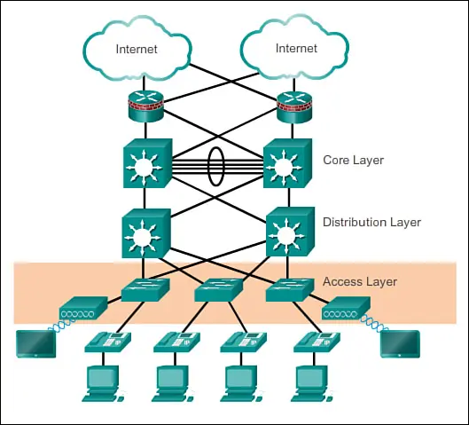
- (Cisco Press, 2014)

> Speaker notes: Hierarchical design is the cornerstone of scalability.  Core Layer: High-speed routers running EIGRP/BGP handle traffic between distribution layers. Distribution Layer: Aggregates access-layer traffic and enforces policies (e.g., QoS). Access Layer: Connects end devices with port-security and VLANs.  ECMP ensures no single path is overwhelmed. For example, two core routers with equal OSPF costs split traffic using a hash of source/dest IPs and ports. If one path fails, traffic instantly shifts to the other.  Why dynamic routing? Static routes can’t scale. EIGRP automatically detects new networks and finds optimal paths, while BGP handles complex policies for cloud and WAN connections

##### Slide 10

- Designing for Resilience

> Speaker notes: BGP PIC is a game-changer. Traditional BGP convergence can take minutes as routers recalculate paths. PIC precomputes backup routes, so a fiber cut triggers an instant reroute. For example, if your primary ISP link drops, traffic shifts to the backup in <1 second.  TACACS+ redundancy uses a VIP that floats between servers. Health checks every 5 seconds ensure failover within 10 seconds. If the primary server crashes, devices keep authenticating without interruption.

##### Slide 11

- Key Threats & Impacts

> Speaker notes: Lets quantify risks. A DDoS attack attack flooding a 10 Gbps link can cost an estimated 50 thousand an hour in down time. We can mitigate this with rate limiting. Rate limiting activates when traffic exceeds a certain threshold per the source IP.   Cloud Scrubbing – redirects suspicious traffic to our provider CloudFare to filter attacks  Rouge Devices are stealthy. A hackers raspberry pi plugged into a lobby ort can mimic authorized MAC addresses, pivot laterally, and deploy ransom ware.  Mitigations include port-security, and the utilization of the 802.1x. Which is a network access control protocol that provides port-based authentication.   Insider Threats are the hardest to detect. An disgruntled admin could delete VLANs or modify ACLs.   TACACS+ RBAC (role based access control) – restricts system access based on roles.  Security Information and Event Manager (SIEM)

##### Slide 12

- Mitigations Strategies
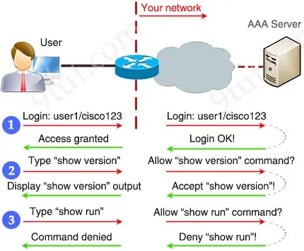
- (CCNA Training» AAA TACACS+ and RADIUS Tutorial, 2025)

##### Slide 13

- Monitoring Traffic – Proactive Defense

> Speaker notes: Security Information and Event Management (SIEM) is a cybersecurity solution that collects, analyzes, and correlates security data from various sources in an organization's network to detect and respond to threats. Data Collection – SIEM gathers logs and security events from different sources, such as firewalls, intrusion detection systems, servers, and applications.  Normalization & Correlation – It standardizes log formats and correlates different events to identify patterns that could indicate security threats.  Real-time Monitoring – SIEM continuously analyzes incoming data to detect suspicious activity or anomalies.  Alerting & Reporting – If an anomaly is detected, SIEM generates alerts and detailed reports for security teams to investigate.  Incident Response – Some SIEM solutions integrate with automated response tools to take immediate action against threats, such as blocking malicious IPs or isolating compromised systems.  By providing centralized visibility into security events, SIEM helps organizations improve threat detection, compliance, and response times.

##### Slide 14

- Conclusion

> Speaker notes: In conclusion, this architecture isn’t just a checklist of technologies—it’s a holistic approach to solving real-world problems. Whether it’s a rogue device in a hospital or a DDoS attack on a trading platform, each component plays a role in detection, mitigation, and recovery. I’d love to hear your thoughts—what challenges are you facing in your network today?"

##### Slide 15

- Refrences
- Cisco Press. (2014, May 9). Hierarchical Network Design Overview (1.1) > Cisco Networking Academy Connecting Networks Companion Guide: Hierarchical Network Design. Www.ciscopress.com. https://www.ciscopress.com/articles/article.asp?p=2202410&seqNum=4
- NIST. (2024). The NIST Cybersecurity Framework (CSF) 2.0. The NIST Cybersecurity Framework (CSF) 2.0, 2.0(29). https://doi.org/10.6028/nist.cswp.29

##### Slide 16

- Questions

---

*Binary file (pkt, data); not converted to text. Original kept in the local CouseWork folder.*
