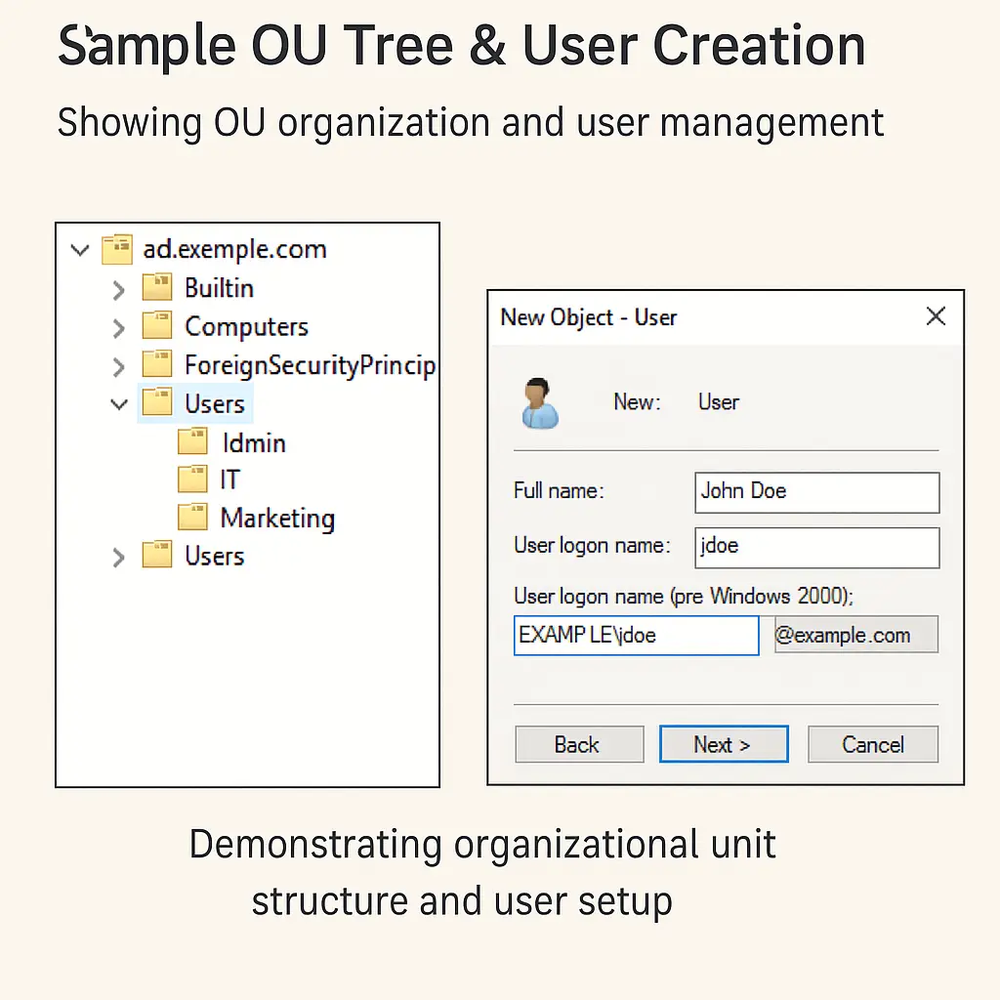
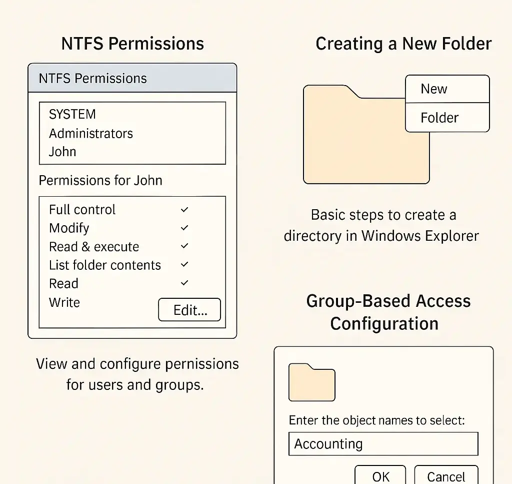
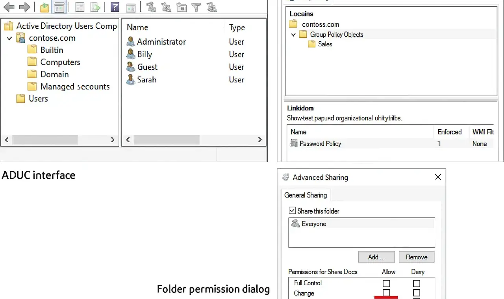
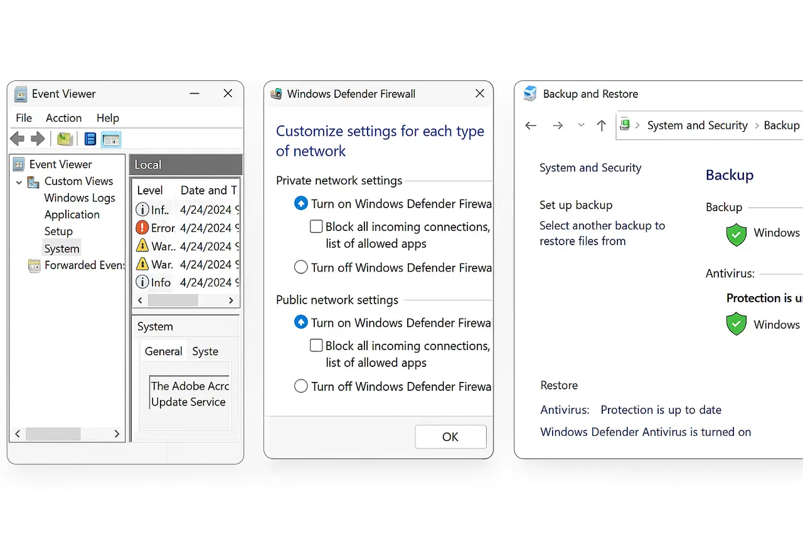

# Windows Accounts, Shared Folders and Security Monitoring Plan

**Course:** CYB240L Windows Client and Server Lab · ECPI University · May 2025  
**Work:** Individual

## Scenario

A four-phase Windows client and server project covering user and group design, shared-folder permissions, remote management and security monitoring and maintenance.

## Skills and tools

- **Skills:** Windows administration, Access control, Security monitoring
- **Tools and references:** Windows Server, Event Viewer, NTFS / share permissions

## My work

*Converted from my original submission. The assignment prompt, grade and instructor feedback are not included.*

##### Slide 1

- Windows Client & Server Project
- Managing Account Resources and Shared Folders – Phases 4

##### Slide 2

- Phase 1 – Account Management Fundamentals
- Objective: Understand and design auser/group structure for a domainenvironment.

##### Slide 3

- User and Group Accounts
- User Accounts
- This digital identity is created to allow a person to log in to a network.
- Used to verify the user’s identity, attempting to gain access to the system. This also determines what the user can access and what actions they can perform (Microsoft, 2022)
- Security Groups
- This collection of user accounts can be managed as a single unit.
- These are used for simplified administration instead of assigning permissions to every user. (Microsoft, 2022)

##### Slide 4

- Local V. Domain Accounts
- Local account
  - The account is stored on the individual computer and is only valid for that computer. Sharing access to network resources is also limited and must be granted individually.
  - This account should be used when not connected to a domain, such as a testing environment or a small isolated environment (idiadmin, 2022)
- Domain account
  - This account is stored in Active Directory on a domain controller, a specialized server. Accounts can also be accessed from all computers within the domain. Shared network resources like files or printers can be seamlessly accessed.
  - This account should be used for centralized authentication and authorization, and when you need to enforce Group Policies and security rules. (idiadmin, 2022)

##### Slide 5

- Organizational Structure

##### Slide 6

- Phase 1 Visuals

##### Slide 7

- Phase 2 – Shared Folders and Access Control
- Objective – Configure shared folders and apply group-based permissions

##### Slide 8

- Understanding Permission Models
- NTFS (New Technology File System) offers granular levels of control, meaning it can determine permissions at the file and folder level. The permissions apply to local and network users and are always effective. Files will inherit permissions from the parent folders.
- Share Permissions are applied to shared folders using the sharing tab. However, they only offer folder-level access control. The permissions only apply to network users when connected to the network. (Nikolaisen, 2019)
- Principle of Least Privilege (PoLP) – is giving users and systems the minimum level of access or permissions to perform their job (Palo Alto Networks, 2024)

##### Slide 9

- Permissions Matrix

##### Slide 10

- Visuals – Folder Sharing and Permissions

##### Slide 11

- Phase 2 Summary
- Plan folder structure and access requirements
  - Define the purpose of shared folders and identify required access levels
  - Map out a logical folder hierarchy based on departments, projects, or security needs
- Create and Configure Active Directory Groups
  - Role-Based Groups for permissions
  - Resource-Based Groups for specific folders
  - Nest groups if needed
- Assign Folder Permissions via NTFS & Share Permissions
  - NTFS Permissions: Set granular access on folders using AD groups
  - Share Permissions: Ensure everyone is removed; restrict to Authenticated Users or specific AD groups
  - Follow the least privilege principle

##### Slide 12

- Phase 3: System Administration and UserManagement
- Objective:Perform user, group, and policy administration ina Windows Server domain environment.

##### Slide 13

- Active Directory Administration
- A fast way to make a user and group is to first navigate to the PowerShell.
- To create a user, enter the following: net user username password /add
- To create a group, enter the following: net localgroup groupname /add
- To add a user to the group, enter the following: net localgroup groupname username /add
- To view users and groups, enter the following: net user, net localgroup

##### Slide 14

- Best Practices for Passwords
- Password Polices:
  - Minimum Length: At least 12 characters
  - Complexity: Use uppercase, lowercase, numbers, and symbols
  - Expiration: Set to expire every 60–90 days
  - History: Prevent reuse of the last 5–10 passwords
  - Storage: Always hash passwords (e.g., bcrypt, SHA-256 with salt)
- Account Lockout Policies:
  - Threshold: Lock account after 3–5 failed login attempts
  - Duration: Lockout duration should be 15–30 minutes or until admin unlocks
  - Reset Counter: Reset failed attempts count after 15 minutes of no failures
- Additional Recommendations:
  - Use MFA (Multi-Factor Authentication)
  - Monitor logs for brute-force attempts
  - Disable unused accounts promptly
  - Enforce password policies via GPO (Group Policy Object) in Windows environments
- (Szentgyorgyi-Siklosi, 2023)

##### Slide 15

- Group Policy Management
- How to Apply a GPO to an OU
- Open the Group Policy Management Console (GPMC)
  - Press Win + R, type gpmc.msc, and hit Enter.
  - This opens the GPMC interface, where you can manage all GPOs and OUs.
- Create a New GPO:
  - In the left pane, right-click on Group Policy Objects, then New.
  - Give the GPO a clear name
- Edit the GPO:
  - Right-click the GPO you created, then edit.
  - Use the Group Policy Management Editor to configure your settings under:
    - Computer Configuration or User Configuration
    - Policies, then Windows Settings, then Security Settings
- Link the GPO to an OU:
  - In the GPMC, find the OU where your users or computers reside.
  - Right-click the OU, then link an existing GPO
  - Select your newly created GPO from the list and click OK.
- (Orin-Thomas, 2024)

##### Slide 16

- Example Policies
- Password policies:
  - Minimum password length
  - Password must meet complexity requirements
  - Maximum password age
- Desktop Restrictions
  - Prevent access to Control Panel
  - Hide “Run” command
  - Set a specific desktop wallpaper (company logo)
  - Disable Task Manager

##### Slide 17

- What is Group Policy Management Console?
- GPMC is a Microsoft Management Console (MMC) snap-in used to create, edit, link, back up, and manage Group Policy Objects (GPOS) across domains and organizational units within Active Directory.
  - Key Uses
    - GPMC is mostly used as centralized management of user or computer configurations
    - Assigns policies to specific Ous.
    - Delegate Group Policy administration
    - Troubleshoot and model policy application
- (Orin-Thomas, 2024)

##### Slide 18

- Shared Folders
- A shared folder is a directory on a PC or server configured to be accessible over a network by other users.
- To create a Shared Folder, you must first create the folder.
  - Right-click on the desktop, then choose New, then Folder, and give the new folder the name “Shared”
- Share the Folder
  - Right-click the folder, then select Properties
  - Go to the sharing tab, then click Advanced Sharing
  - Check “Share this folder”
  - Click Permissions to configure
- Set Network Access
  - Under Network and Sharing Center, ensure:
    - Network Discovery is turned on.
    - File and Printer Sharing should be enabled.
- (walterov, 2022)

##### Slide 19

- Permission Management
- The purpose of configuring NTFS and share permissions is to control who can access specified files and directories, and what they can do with the files
- Once permissions are configured, its essential to test access from a client system that part of the same domain to ensure settings work as expected
- Why Test?
  - Confirms proper authentication using domain credentials
  - Verifies group memberships and policies are applied correctly
  - Ensures that effective permissions are functioning as intended
  - Identifies access issues or permission conflicts before users are affected
  - Validates user experience of mapping drives or file access speed
- (ManageEngine, 2025)

##### Slide 20

- Visuals: AD, GPO, and FolderSharing

##### Slide 21

- Phase 3 Summary
- Admins use ADUC to create and manage users and groups, and apply GPOs via GPMC to enforce settings like password policies and desktop restrictions. Shared folders are secured with both Share and NTFS permissions to control access. Testing from a domain-joined client ensures permissions and policies work correctly. Tools like ADUC, GPMC, and folder permission dialogs help manage these configurations.

##### Slide 22

- Phase 4: Monitoring, Security, and Maintenance
- Objective: Implement monitoring tools, security me3asures, and maintenance tasks in Windows Server.

##### Slide 23

- System Monitoring Tools
- The Task Manager provides a quick, real-time overview of the system performance and the processes that are running.
  - Once Task Manager is open, navigate to the Performance tab. On the left side, you’ll see options such as CPU, Memory(RAM), and the storage disk.
  - CPU displays a real-time graph of overall CPU utilization. You can see the percentage of CPU in use, the CPU name and model, and the specifications of the CPU.
  - Memory: This shows a graph of RAM usage. You’ll see the total physical memory, how much is in use, the amount of cached memory, and the memory speed.
  - Storage Disk: This displays a graph of the activity of the storage drives. You’ll see the read and write speeds in MB/s and the active time percentage, indicating how busy the disk is.
- (Hoffman, 2024)

##### Slide 24

- Performance Monitor: In-Depth Analysis and Logging
- Performance Monitor offers an advanced way to track system performance over time. It allows you to select specific performance counters, or reports, and even log data for later analysis.
  - CPU monitoring: select the processor object. In the “List counters from object” section, you can choose counters like:
    - Processor Time: overall CPU utilization across all processors. You can select a combined view or individual process cores.
  - Memory Monitoring: Select the memory object, then choose counters such as: available Mbytes:
  - Disk Monitoring: Select the PhysicalDisk object. Then monitor the Disk.
- (Lenovo, 2021)
- (Lenovo, 2021)

##### Slide 25

- Event Viewer
- Event Viewer is a tool that records computer events. These events can relate to system operations, security, and applications. While it doesn’t display real-time information like Task Manager or Performance Monitor, it can provide valuable context and identify issues.
  - You can navigate the events for more information and filter them for certain relevant logs.
  - Application logs contain events logged by apps and programs, which usually display errors or warnings related to applications that are consuming excessive resources or crashing
  - System logs contain events logged by the OS components. They are errors related to services, drivers, and other system-level issues that could impact performance.
  - Security logs contain audit logs related to security events such as login attempts or access to resources.
- (Hoffman, 2016)

##### Slide 26

- Security Practices
- Configuring Antivirus (Windows Defender)
  - Open Windows Security.
  - Navigate to Virus & Threat protection.
    - Manage settings: Enable real-time and cloud protection, Run scans, add trusted items, configure controlled folder access for ransomware protection
- Setting up Windows Firewall
  - Open Windows Defender Firewall
  - Allow an app through the firewall, advanced settings for granular controls, specify new rules or ports, allow an action, or block connections, apply to Domains
- Performing System Updates
  - Open Windows Update settings
  - Check for updates
  - Download and then install
- (Microsoft, 2019)

##### Slide 27

- System Maintenance Tasks
- Disk Cleanup: Removes unnecessary files (temporary internet files, system error reports, recycle bin contents)
  - Benefits: Frees up valuable disk space, potentially improves system performance by reducing the number of files the system needs to manage
- Disk Defragmentation: It reorganizes fragmented data on an HDD so related file parts are stored together.
  - Benefits: Faster file access by reducing the time it takes for read and write to locate all parts of the file, and improved overall system responsiveness
- Backup Configuration: Process of setting up a system to regularly create copies of critical data and settings
  - This ensures data can be recovered in case of hardware failure, software corruption, or other data loss events

##### Slide 28

- Visuals: Monitoring and Security Tools

##### Slide 29

- Final Project Summary
- Planning
  - Assessment of Needs: Determine hardware, software, user, and network requirements
  - Budgeting and Scheduling: Allocate resources and set realistic timelines
  - Risk Management: Identify potential threats and plan contingencies
  - Documentation: Create detailed implementation plans and network diagrams
- Installation
  - Hardware Setup: Physically install and connect devices, ensuring compatibility
  - Operating System & Software Installations: install and configure OS and essential applications
  - Initial network configuration: assign IPs, set up DNS, DHCP, and default gateway settings
  - Testing: Verify functionality before deployment
- Administration
  - User and Resources Management: Create user accounts, assign roles, and manage permissions
  - Policy Enforcement: Apply security and usage policies using group policies or equivalent tools
  - Backup & Recovery: Implement regular data backups and test recovery procedures
  - Updates & Patching: Keep systems updated to close security vulnerabilities
- Monitoring & Security
  - Event Viewer and Logs: Regularly monitor logs for abnormal activities or failures
  - Firewall & Antivirus: Ensure firewall rules are properly configured and antivirus is up to date
  - Performance Monitoring: Use tools to track CPU, memory, and network usage
  - Alerts & Incident Response: Set up alerting mechanisms and have a response plan for breaches or failures

##### Slide 30

- References
- Hoffman, C. (2016, September 26). What Is the Windows Event Viewer, and How Can I Use It? How-to Geek; How-To Geek. https://www.howtogeek.com/123646/htg-explains-what-the-windows-event-viewer-is-and-how-you-can-use-it/
- Hoffman, C. (2024, April 5). How to turn the Task Manager into a floating system monitor | The Intelligence. The Intelligence. https://theintelligence.com/32361/how-to-turn-the-task-manager-into-a-floating-system-monitor/
- idiadmin. (2022, December 15). What is the difference between a local account and a domain account. Pisys - Business IT Support Company. https://www.pisys.net/knowledge-base/microsoft-solutions/what-is-the-difference-between-a-local-account-and-a-domain-account/
- Lenovo. (2021). Performance Monitor Explained: What You Need to Know | Lenovo US. Lenovo.com. https://www.lenovo.com/us/en/glossary/what-is-performance-monitor/
- ManageEngine, communications@manageengine.com. (2025). Permission Management | User Configuration | ManageEngine Endpoint Central. Manageengine.com. https://www.manageengine.com/products/desktop-central/help/user_configuration/managing_user_file_folder_permissions.html
- Microsoft. (2019). Windows 10 Security, Windows Defender Antivirus, Windows Defender Security Center, Firewall & Windows Hello. Microsoft.com. https://www.microsoft.com/en-us/windows/comprehensive-security
- Microsoft. (2022, October 5). Active Directory security groups. Learn.microsoft.com. https://learn.microsoft.com/en-us/windows-server/identity/ad-ds/manage/understand-security-groups
- Nikolaisen, N. (2019, April 18). NTFS Permissions and Share Permissions – What’s the difference? Tenfold Security. https://www.tenfold-security.com/en/ntfs-permissions-and-share-permissions-whats-the-difference/
- OpenAI. (2025). ChatGPT. ChatGPT; OpenAI. https://chatgpt.com/
- Orin-Thomas. (2024, April 22). Group Policy Management Console in Windows. Learn.microsoft.com. https://learn.microsoft.com/en-us/windows-server/identity/ad-ds/manage/group-policy/group-policy-management-console
- Palo Alto Networks. (2024). What Is the Principle of Least Privilege? Palo Alto Networks. https://www.paloaltonetworks.com/cyberpedia/what-is-the-principle-of-least-privilege
- Szentgyorgyi-Siklosi, A. (2023, April 11). Active Directory Account Lockout Policy Best Practices. Lepide Blog: A Guide to IT Security, Compliance and IT Operations. https://www.lepide.com/blog/active-directory-account-lockout-policy-best-practices/
- walterov. (2022, June 4). Share and NTFS Permissions. Learn.microsoft.com. https://learn.microsoft.com/en-us/iis/web-hosting/configuring-servers-in-the-windows-web-platform/configuring-share-and-ntfs-permissions
